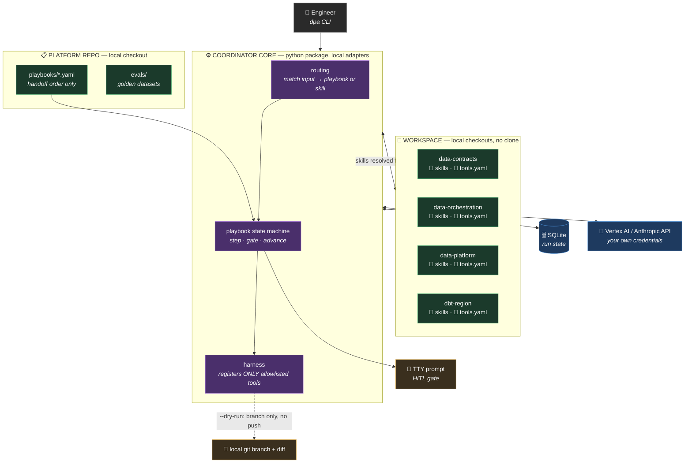
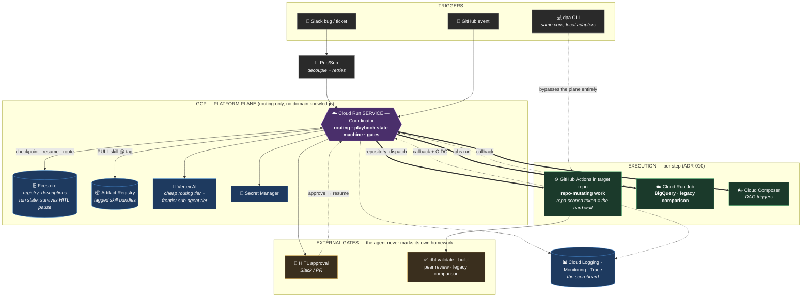
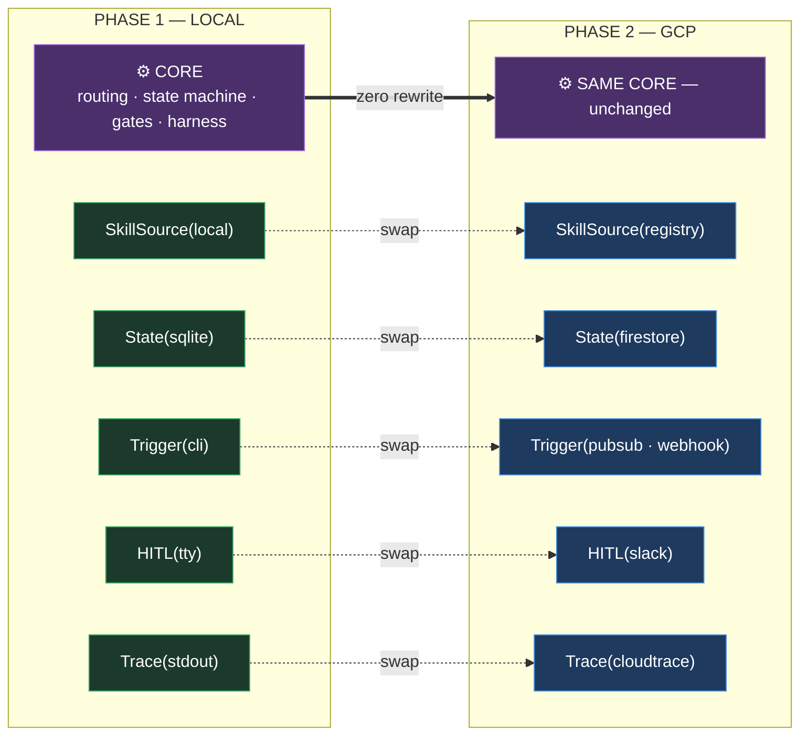

# Action Plan — Local POC → GCP MVP

*Build order for the agentic platform described in "It's not about what you know but who you know" and its architecture addendum. Two phases: prove the thesis on a laptop, then make it durable on GCP.*

> **The organising rule:** every phase must produce something useful **if the next phase never happens.** Phase 1 leaves you with documented workflows and a working CLI. Phase 2 leaves you with an event-driven platform. Neither is a half-built system waiting on the other.

---

## 0. The Shape of the Plan

```mermaid
flowchart LR
    subgraph p0["PHASE 0 — Decide<br/><i>~1 week</i>"]
        direction TB
        a0["Pick the bottleneck workflow"]
        b0["Pick the cross-repo workflow"]
        c0["Verify harness tool scoping"]
    end
    subgraph p1["PHASE 1 — Local POC<br/><i>~5 weeks</i>"]
        direction TB
        a1["Skills, hand-authored"]
        b1["CLI + core, local adapters"]
        c1["Playbook + cross-repo run"]
        d1["Evals + tool enforcement"]
    end
    subgraph p2["PHASE 2 — GCP MVP<br/><i>~7 weeks</i>"]
        direction TB
        a2["Registry + push-on-tag"]
        b2["Actions execution path"]
        c2["Coordinator on Cloud Run"]
        d2["HITL, observability, scoreboard"]
    end

    p0 ==> p1 ==> p2
    p1 -.->|"value stands alone:<br/>docs + working CLI"| v1["✅"]
    p2 -.->|"value stands alone:<br/>event-driven platform"| v2["✅"]

    classDef d fill:#2a2a2a,stroke:#888,color:#fff
    classDef l fill:#1b3a2b,stroke:#3fa66a,color:#fff
    classDef c fill:#1e3a5f,stroke:#4a90d9,color:#fff
    classDef v fill:#4a2f6b,stroke:#a06bd9,color:#fff
    class a0,b0,c0 d
    class a1,b1,c1,d1 l
    class a2,b2,c2,d2 c
    class v1,v2 v
```

**Durations are effort estimates for one engineer at roughly 60% allocation.** Treat them as sequencing, not commitments.

---

## Phase 0 — Decide Before You Build (~1 week)

Three decisions gate everything. None of them require code.

### 0.1 Pick one local bottleneck workflow

Run the framework's three steps for real, on paper, and write the answer down:

1. Which SDL are you standing in?
2. Which workflow *inside* the box — not the box?
3. Does an agent here violate the cost or quality gate?

**Choose the workflow that satisfies all four:** high frequency, painful today, verifiable by an existing check, and low blast radius. The document already names the likely candidate — the scaffolding an engineer rebuilds for every model (Bronze/Silver configs, dedup, SCD, mapping) in `dbt-region`.

**Record the baseline now, before any agent exists.** Median hands-on minutes from ticket to PR, over the last 10 instances. Without this number the scoreboard is unfalsifiable, and the whole "speed is read after" discipline collapses into vibes.

### 0.2 Pick one cross-repo workflow

`new-ingestion-field` is the natural choice — it's the four-repo example the document already uses, and it exercises every handoff.

### 0.3 Verify harness tool scoping — the one real spike

Per addendum §A2.3, this threatens **cost and quality**, not security. But you still need to know the answer before designing around it.

**The spike:** stand up your chosen harness, register two tools, invoke with an allowlist naming one, and confirm the second is not in the model's tool list. One afternoon.

| Outcome | What changes |
|---|---|
| Harness scopes tools | Proceed as designed |
| It doesn't | Wrap tool dispatch yourself: a middleware that rejects any call outside the active skill's allowlist. Adds ~a day. Not a blocker. |

### Phase 0 exit criteria

- [ ] One local workflow chosen, with a written gate verdict
- [ ] Baseline cycle-time recorded (median of ≥10 instances)
- [ ] One cross-repo workflow chosen
- [ ] Harness scoping spike answered
- [ ] `data-platform-agents` repo created, empty, with CODEOWNERS

---

## Phase 1 — The Local POC (~5 weeks)

### What the POC must prove

Four claims, and nothing else. Scope discipline here is what keeps the phase to five weeks.

| # | Claim | How you know |
|---|---|---|
| 1 | A skill file captures enough scar tissue that an agent produces a reviewable PR | A human reviewer accepts the PR with only minor comments |
| 2 | A playbook can sequence four repos without the coordinator knowing any domain | Diff the coordinator's prompt: zero dbt/contract vocabulary |
| 3 | Selective invocation keeps context small | Token count per run is flat as skill count grows from 1 → 10 |
| 4 | Local iteration on skills is pleasant enough that people will do it | Edit a skill, re-run, see the change — under 60 seconds, no tagging |

### 1.1 Local POC architecture

### 1.2 Milestone P1.1 — One skill, no agent (week 1)

Ship the document's Step 1 for a single workflow. **This has value with nothing else built.**

- [ ] Write `dbt-region/.agents/skills/build-conformed-dimension.md` with the full §8.1 frontmatter contract
- [ ] Fill the body with real scar tissue — the configs, the conventions, the rule nobody wrote down
- [ ] Write `dbt-region/.agents/tools.yaml` declaring `dbt_build`, `dbt_validate`, `read_repo`
- [ ] Merge through normal PR review, CODEOWNERS approval

**Acceptance:** an engineer who has never built a conformed dimension can follow the skill file by hand and produce a correct one. If they can't, the skill isn't done — and no agent will rescue it.

### 1.3 Milestone P1.2 — The CLI and the core (weeks 2–3)

- [ ] `dpa` CLI scaffold; core as an importable package with adapter interfaces
- [ ] Adapter implementations: `SkillSource(local)`, `State(sqlite)`, `Identity(adc)`, `HITL(tty)`, `Trace(stdout)`
- [ ] Workspace resolution (`workspace.yaml` → local paths)
- [ ] Harness: register **only** the tools the active skill declares
- [ ] Tool dispatch middleware: reject any call outside the active allowlist, log the attempt
- [ ] `--dry-run` default: write to a local branch, never push
- [ ] Stopping conditions from frontmatter (max iterations, token budget) enforced in the loop
- [ ] `dpa run-skill build-conformed-dimension --repo dbt-region --input dim_merchant`

**Acceptance:** the command produces a diff a reviewer would accept. Token count for the run is logged. Deliberately calling an undeclared tool is refused and logged.

### 1.4 Milestone P1.3 — Playbook and the cross-repo run (week 4)

- [ ] Playbook schema + loader in the platform repo
- [ ] Write `playbooks/new-ingestion-field.yaml` (four steps, referencing `skill@version`)
- [ ] State machine: execute step → evaluate gate → checkpoint → advance
- [ ] Write the three remaining skills — one per participating repo
- [ ] `dpa run new-ingestion-field --workspace ... --skill-source local --dry-run`
- [ ] Kill the process mid-run; confirm resume from checkpoint

**Acceptance — and this is the load-bearing test of the whole thesis:**

> **Grep the coordinator's assembled prompt for domain vocabulary.** No `dbt`, no `SCD`, no `contract`, no repo-specific nouns. If they're there, knowledge has leaked into the router and ADR-003 is already broken.

### 1.5 Milestone P1.4 — Evals and cost proof (week 5)

- [ ] Golden dataset per skill: 5–10 human-validated inputs with trusted outputs
- [ ] LLM-as-judge with an explicit rubric, pinned to a **different** model family than production
- [ ] Trajectory scoring: did it pick the right skill, in the right order, with the right tools
- [ ] Routing evals for the playbook — the coordinator's own test suite
- [ ] **Cost experiment:** run the same task with 1, 5, and 10 skills present in the workspace. Plot tokens per run.

**Acceptance:** tokens per run stay flat as skill count grows. If they climb, skills are being preloaded, not invoked — which is the failure the main document explicitly warns about (§10, "preload a repo's skills and you've rebuilt the mega-agent inside a single repo"). Fix it here, in a laptop, not in production.

### Phase 1 exit criteria — the gate into Phase 2

- [ ] Four skills merged and owned by their repos' CODEOWNERS
- [ ] One playbook executes four repos end to end, producing four reviewable diffs
- [ ] Coordinator prompt contains zero domain knowledge (verified by grep, in CI)
- [ ] Token count per run flat from 1 → 10 skills
- [ ] Edit-a-skill-and-rerun loop under 60 seconds
- [ ] Eval suite green; routing evals green
- [ ] **A human reviewer has accepted at least 3 agent-produced PRs**

> **If the last box fails, do not start Phase 2.** Cloud infrastructure does not improve output quality; it only makes bad output faster and more expensive. Go back to the skill bodies.

---

## Phase 2 — The GCP MVP (~7 weeks)

### 2.1 Target architecture

### 2.2 Milestone P2.1 — Registry and push-on-tag (week 1)

- [ ] Firestore collection: `skill name → description → owning repo → latest tag`
- [ ] Artifact Registry repository for skill bundles
- [ ] Reusable GitHub Actions workflow: on release tag, push **whole skill file** under that tag (immutable) + upsert description in Firestore
- [ ] Roll it out to all four repos
- [ ] `SkillSource(registry)` adapter: pull latest tag by default, pinned version when specified
- [ ] Hybrid sync: nightly reconcile pull to catch failed publishes

**Acceptance:** merge a skill change with a tag → the registry reflects it within a minute. `dpa run --skill-source registry` produces the same result as `--skill-source local` did. **This is the first real test of the adapter seam.**

### 2.3 Milestone P2.2 — The Actions execution path, no Cloud Run yet (weeks 2–3)

Per addendum §A4.5: **skip Cloud Run for as long as you can.**

- [ ] Reusable `agent-step` workflow, installed in each repo, listening on `repository_dispatch`
- [ ] WIF: each repo's workflow authenticates to GCP with a per-repo service account; no keys
- [ ] Step runs the coordinator core in single-step mode, pulls its skill from the registry, opens a PR
- [ ] **Orchestrator workflow in the platform repo:** reads the playbook, dispatches step by step, polls for completion
- [ ] Payload schema validation on both ends — structured fields only, never free text (§A5)

**Acceptance:** `new-ingestion-field` runs end to end from a manual `workflow_dispatch` and produces four PRs across four repos. No Cloud Run, no Firestore run state, no Pub/Sub. **You now have a working cloud system.** If budget or appetite runs out here, you have shipped something real.

### 2.4 Milestone P2.3 — Coordinator on Cloud Run, durable (weeks 4–5)

Now lift it, because you need Slack triggers and multi-day pauses.

- [ ] Coordinator as a Cloud Run service; `Trigger(pubsub|webhook)` and `State(firestore)` adapters
- [ ] Pub/Sub topic + push subscription; Slack event webhook
- [ ] **Deterministic mediation before dispatch** — validate, sanitize, classify, emit structured payload (§A5)
- [ ] Replace polling with OIDC-validated callbacks from Actions
- [ ] Per-run and per-tenant token budgets with hard caps
- [ ] Cheap routing model tier; frontier tier for sub-agents; escalation-on-failure
- [ ] Prompt caching on skill bodies (stable cacheable prefix)
- [ ] Idempotency keys on every mutating action
- [ ] Retries with exponential backoff + jitter; circuit breaker per repo

**Acceptance:** post a bug in Slack → four PRs appear. Kill the Cloud Run revision mid-run → the run resumes on the next revision. Send a Slack message containing prompt-injection text → it never reaches a runner as free text.

### 2.5 Milestone P2.4 — Gates, observability, scoreboard (weeks 6–7)

- [ ] HITL gate in Slack with approve/reject/send-back; run suspends and persists
- [ ] Gate list wired: contract modification, prod dbt deploy, prod DAG trigger, anything irreversible
- [ ] OpenTelemetry GenAI tracing; **one trace ID propagated through dispatch and callback** so Actions spans and Cloud Run spans land in one tree
- [ ] Cost and latency per span, attributed to workflow and skill
- [ ] Eval regression gate in CI: a skill-file merge blocks if any metric drops
- [ ] Audit trail: which agent, which skill **version**, what inputs, what side effects
- [ ] **The scoreboard dashboard:** cycle-time delta vs. the Phase 0 baseline, gate pass rates, cost per workflow, misroute rate

**Acceptance:** you can open one dashboard and answer *did this pay off* with a number, not an opinion.

### Phase 2 exit criteria

- [ ] Slack-triggered cross-repo workflow produces PRs across four repos
- [ ] Runs survive revision restarts and multi-day HITL pauses
- [ ] Every mutating action gated; no agent approves its own output
- [ ] Single trace spans coordinator → Actions → callback
- [ ] Scoreboard shows cycle-time delta against the Phase 0 baseline
- [ ] Cost per workflow inside budget, with hard caps enforced
- [ ] Injection test: untrusted text never reaches a runner unmediated

---

## 3. Migration Path — Why Phase 1 Isn't Thrown Away

**Phase 2 replaces five adapters. It rewrites nothing.** And the local path never becomes legacy — it stays the authoring loop engineers use every day to iterate on skills before tagging them.

**Guard the seam in CI:** one golden playbook runs through **both** adapter sets on every runtime PR. The moment local and cloud diverge, a test fails rather than an engineer discovering it at 2am.

---

## 4. What Not to Build (Yet)

Scope defence. Each of these is in the main document and each is correctly deferred.

| Deferred | Why | Revisit when |
|---|---|---|
| Escalating skills to full sub-agents (ADR-007) | Nothing has demanded isolation, parallelism, or independent failure yet | A gate actually demands it — not before |
| Composing new agents from the registry | Needs a populated registry first; premature with four skills | ~20 skills across repos |
| Parallel cross-repo steps | Credeq's pipeline is strictly sequential today | A playbook has genuinely independent branches |
| Vertex AI Agent Engine | Cloud Run is already understood; managed runtime is a swap, not a redesign | Owning the host becomes the bottleneck |
| Critic / review-and-critique in production | Human review is the gate during MVP | Human review becomes the bottleneck |
| Agents for DAG triggers and merges (ADR-006) | A GitHub workflow already does this for near-nothing | Never — this is a cost-gate violation by design |

---

## 5. Build Risk Register

| Risk | Signal it's happening | Response |
|---|---|---|
| **Skill bodies too thin** | Reviewers reject agent PRs on domain correctness | Stop. Fix the skill, not the prompt. The skill *is* the product. |
| **Knowledge leaks into the coordinator** | Domain nouns appear in the router's prompt | CI grep gate from P1.3; fail the build |
| **Skills get preloaded** | Tokens per run climb with skill count | The P1.4 cost experiment catches it before cloud spend does |
| **Phase 2 starts before Phase 1's quality gate passes** | Cloud work begins with <3 accepted PRs | Hard stop. Infrastructure cannot fix output quality. |
| **Adapter seam rots** | Local and cloud produce different results | Dual-adapter golden test on every runtime PR |
| **Playbook references a deleted skill** | Run fails mid-sequence, halfway through four repos | Playbook CI resolves every `skill@version` against the registry |
| **Scope creep into escalation/composition** | Sub-agent sandboxes appear in Phase 1 tickets | §4 is the answer; ADR-007 requires a gate to demand it |
| **No baseline recorded** | Nobody can say whether it worked | Phase 0 exit criterion; do not skip it |

---

## 6. The One Number That Decides Everything

Everything above is scaffolding around a single question the document already frames correctly: **speed is a scoreboard, read after.**

> **Median hands-on minutes from ticket to merged PR** for the Phase 0 workflow — baseline vs. post-launch, with cost per workflow and gate pass rate beside it.

If that number doesn't move, the honest response is the one the framework already licenses: **no is a fine answer.** Keep the skills — they earned their keep as documentation in Phase 1 — and retire the agent.
