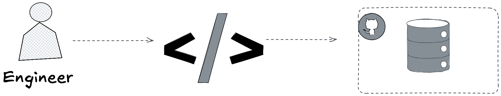
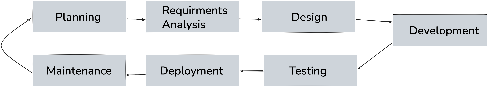
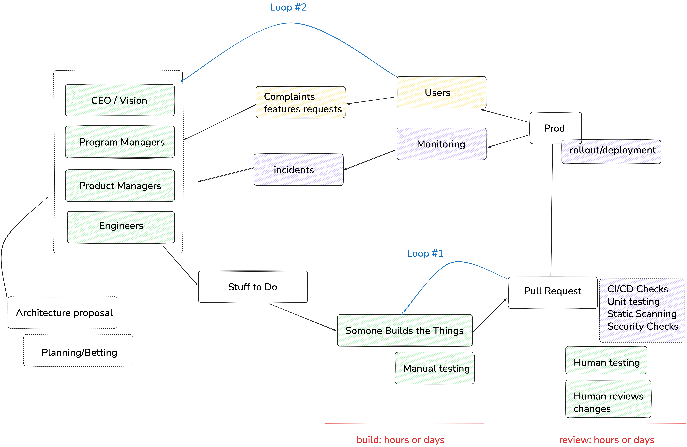
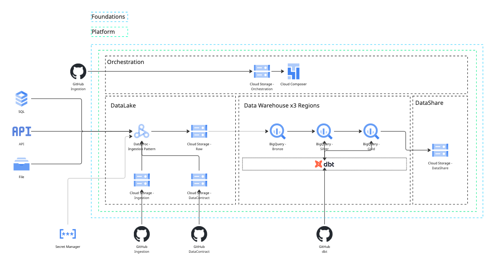

# We Are Giving Smart Models Dumb Work
*Scaling Credeq's developer operations with AI agents, and why finding the right bottleneck, not just the right agent, is what gets things done quicker.*

## The Trade

Knowing which tool to use is table stakes. Any engineer can learn that in a year. The good ones build tools instead. The great ones build tools that build leverage, systems that let one person's judgment do the work of ten pairs of hands. None of this is new. Documentation, linters, CI pipelines, and now agents are the same instinct wearing a new outfit. We keep discovering the wheel and calling it innovation.

Credeq runs on 7 repositories. Each one is its own little kingdom, run by engineers who know its scar tissue better than anyone else on earth ever will. Now put AI agents to work inside those repos. They show up smart. What they don't show up with is the local kind, the particular scar tissue of this repo, this region, the one config nobody ever bothered to write down because everyone just knew. That gap is real, and I'll save you the suspense: it's not the interesting part.

The interesting part is that the constraint from the first paragraph never left, it just changed clothes and moved into a new office. Knowing which tool to use was always the engineer's job. Not the tool's. Never was. Bolt an agent onto the workflow and someone, some human, still has to decide whether this is even a job for it, which one, with which context, on which repo. Skip that decision and you haven't gotten rid of the skill requirement. You've just hidden it behind a prompt box and called it progress. The interesting question was never whether agents need context, of course they do, everything does. It's *where that context should live* and, the part everyone would rather skip, who's still on the hook for knowing when the right move is not to reach for an agent at all.

There's a second constraint, and this one costs real money: time. Pick two, they say. Speed, quality, cost. As a codebase grows, that old rule doesn't go away, it just gets harder to dodge. Engineers get forced into a trade. Ship features fast, or keep the system healthy. Rarely both, and never forever.

So here's the actual challenge, and it isn't "add more agents." It's how you get faster without quietly paying for it in quality, or in cash, later.

More agents, aimed right, is one way through that trade. Not one agent for several repos carrying every rule Credeq has ever written. Agents built for the repo they live in, carrying only what that repo needs, and nothing else. That's the shape of the fix. What's still missing is where, exactly, engineers are losing the time in the first place. That's next.

## Framing the Lifecycle

To truly understand how we can scale engineering operations, we first need to agree on what an engineer actually does, and what an engineering operation is.

Strip away the job titles, the standups, the GitHub issues, and it comes down to this: an engineer writes code, and gets that code into a repository. Everything else, the skills they've picked up, the tools they reach for, exists to serve that one act. A linter, a framework, a snippet library, an agent, all of it is just scaffolding around the same two steps. Write the code. Push the code.

That's an oversimplification, obviously. No engineer's job is two steps. But first principles don't need to be polite, they just need to be true, and this one is. Write code, push code, everything else is decoration.

In practice, that decoration is most of the job. The loop grows steps around the core: plan the change, write it, test it, review it, merge it, ship it, watch it in production, then start over the moment something breaks or something new needs building. That longer loop has a name. It's called the software development lifecycle, and it's where the real bottlenecks live.

### The Software Development Lifecycle

The lifecycle itself is not the problem. Planning, requirements analysis, design, development, testing, deployment, maintenance, the loop is fine, it's been fine for decades. The problem is that each of those seven boxes is actually a bundle of a dozen smaller workflows wearing one label, writing tests versus running them, documentation versus code, a hotfix versus a rewrite. Seven boxes was always a map for humans. An engineer fills the gaps with judgment without noticing. An agent can't, not until someone breaks each box down into the workflows actually living inside it.

This lifecycle is not even the entire picture, this just shows you that those original boxes, in a production setting, turn into a whole intricate and complicated set of workflows.

### Scaling the SDL to a Global Data Platform

Credeq's global data platform is multiple repositories, and each one runs its own version of that lifecycle, at its own pace, bottlenecked in its own place, for its own reasons.

- **dbt Region** — dbt modules and transformation logic for a specified region
- **Data Platform Foundations** — the infrastructure as code underneath all of it
- **Data Platform** — the modules that build up the data warehouse itself
- **Data Orchestration** — the Airflow DAGs that keep everything running on schedule
- **Data Contracts** — the contracts that govern what's allowed in from ingestion sources

A slow step in dbt Africa isn't the same bottleneck as a slow step in Data Contracts. Before anyone reaches for an agent: define each of these lifecycles on its own terms, and break each one down to the workflow level.

Each lifecycle decomposes into a set of workflows, and that decomposition is what actually shows engineers where the bottlenecks are, and where tooling would strategically help remove them. That's the real unit of granularity here, not the lifecycle, and not the repo, the workflow underneath both of them.

Multiple lifecycles, each hiding multiple workflows, side by side instead of one. One shared skill file, or one shared agent, can't see this picture, averaging seven different bottlenecks into a single view is how you end up fixing none of them.

## Problem Statement

Putting the problem statement into words.

**Scale Credeq's developer operations with AI agents, without compromising on quality, while increasing engineering velocity.**

Three things in one sentence, and each one can quietly kill the other two. Scale carelessly and quality erodes. Chase velocity and the repos closest to launch cut corners the others won't. Protect quality by slowing everything down and you've just renamed the problem, not solved it. This is the same trade from earlier, speed, quality, cost, just with a fourth lever now sitting on the table: agents.

An AI agent is just another tool, not a strategy, same category as a linter or a CI pipeline. It's only as good as the bottleneck it gets pointed at. Aim it at nothing in particular and it's just an expensive way to feel busy.

### Components

What the problem statement is actually made of, the moving parts that everything above was building toward.

- **Engineers** — the people whose judgment decides which tool gets used, where, and whether an agent belongs in the loop at all.
- **Tool usage** — agents, linters, CI, anything that turns judgment into leverage. Only as good as the bottleneck it's aimed at.
- **Processes** — the lifecycles, global and local, that all of this actually has to run inside.

### Constraints

What the solution isn't allowed to sacrifice to get there.

- **Quality** cannot be compromised.
- **Speed** should increase.
- **Cost** should be minimized.

## Currrent Situation
### Platform Components 
### Back to a workflow
### Types of workflows Global Cross Repo and Local Specific

## Before we insert a agent what is it 
### Angent explenation 
### How a Agent will look in the workflow

## Orchestrator pattern 
## Dewcomposed hyper specific agent pattern 

## Centralized Platform agent

Shortcoming of this approach used alone in the wrong way (No sequential jobs Bug usecase discussed with mike)

What constaints this vialates (Time we need to manage agents centraly which takes me away from myw orkflow)

(Cost a agent is used to do the work a Github workflow is supose to do for me.)

## Archiecture proposal --> ## Hyper specialized colocated Repo agents

-- Constraints to scale developer opperations of 
## How it addresses speed 
## How it maintains quality
## How ir reduces cost 

Final key Takeaways

Summary

