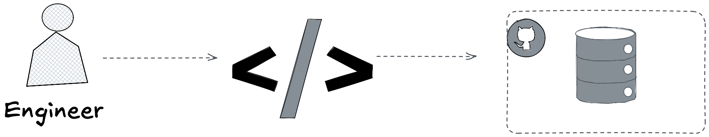
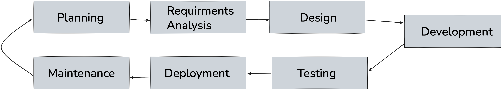
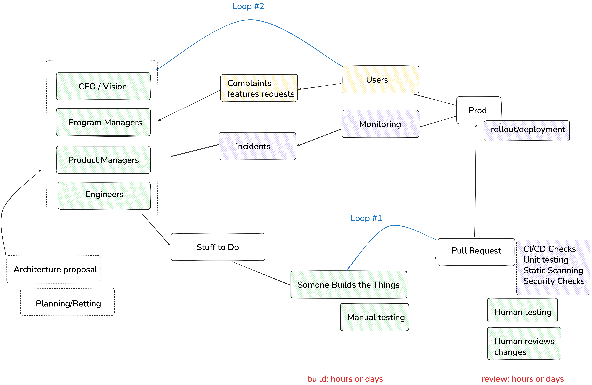
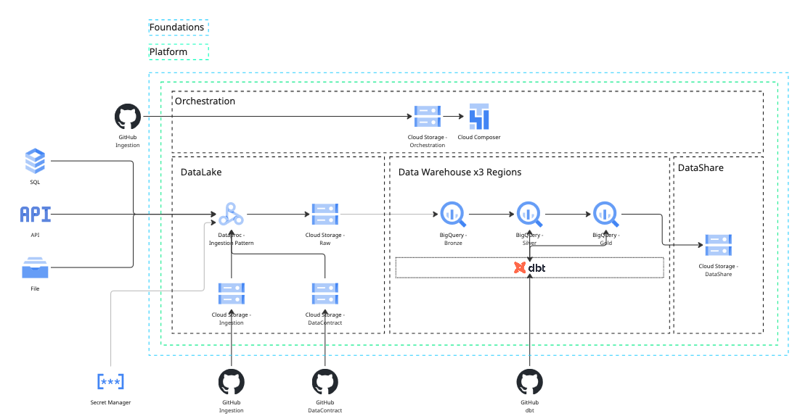
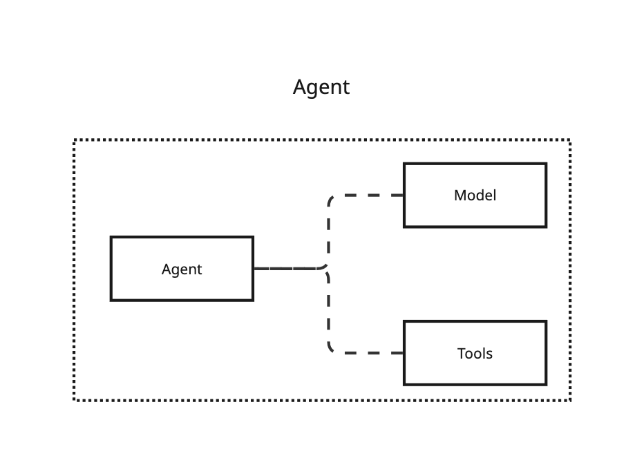
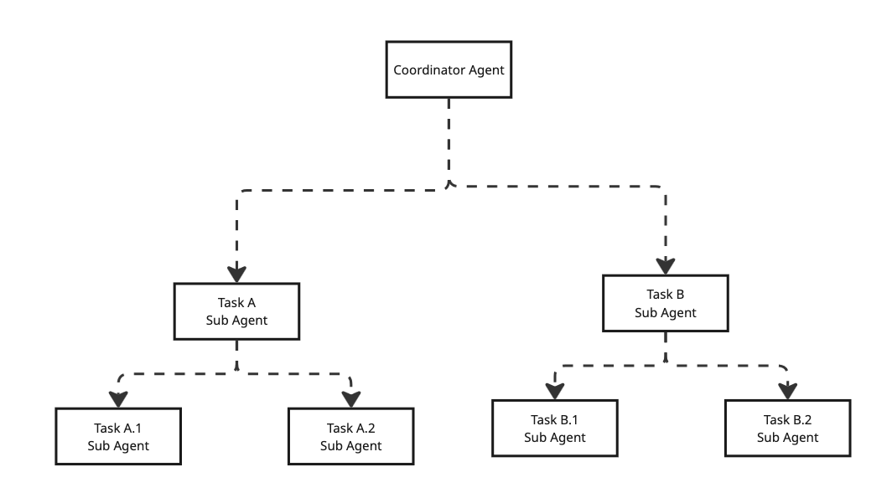
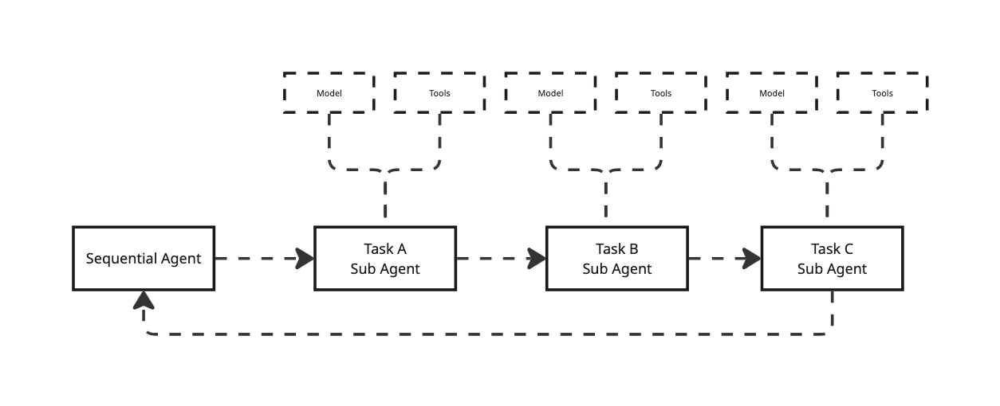
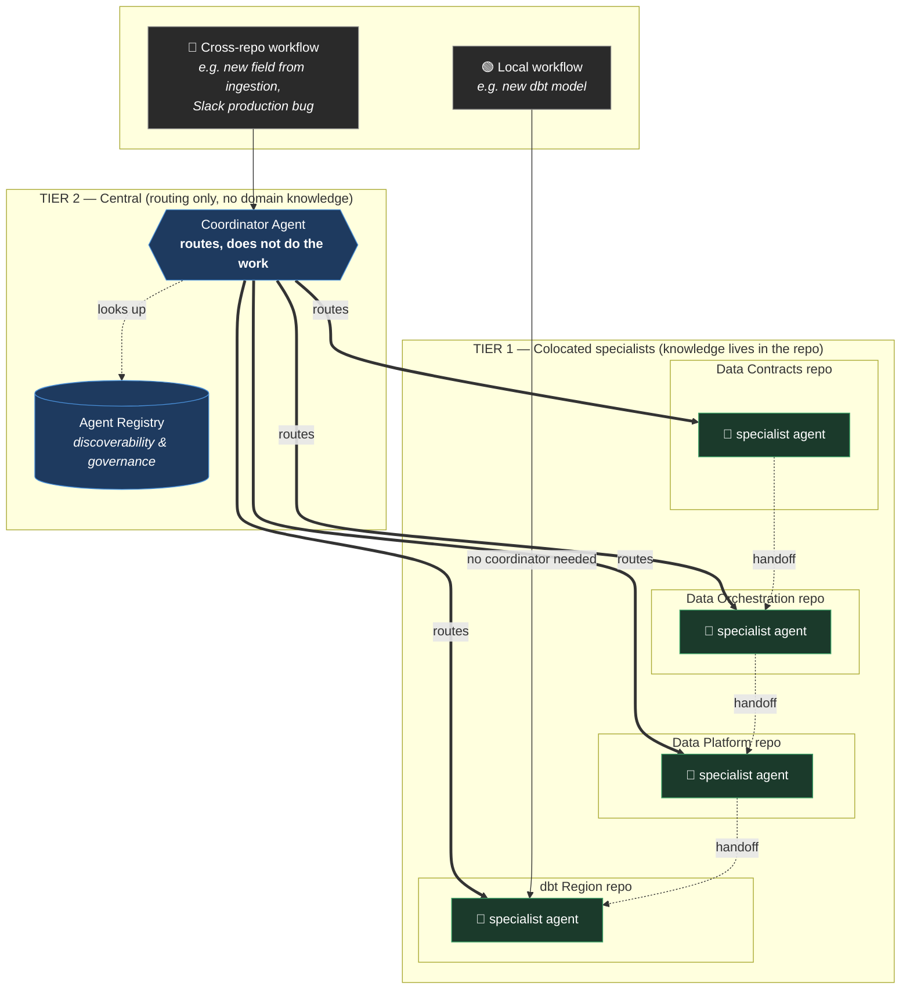

# We Are Giving Smart Models Dumb Work
*Scaling Credeq's developer operations with AI agents, and why finding the right bottleneck, not just the right agent, is what gets things done quicker.*

## The Trade

Knowing which tool to use is table stakes. Any engineer can learn that in a year. The good ones build tools instead. The great ones build tools that build leverage, systems that let one person's judgment do the work of ten pairs of hands. None of this is new. Documentation, linters, CI pipelines, and now agents are the same instinct wearing a new outfit. We keep discovering the wheel and calling it innovation.

Credeq runs on multiple repositories. Each one is its own little kingdom, run by engineers who know its scar tissue better than anyone else on earth ever will. Now put AI agents to work inside those repos. They show up smart. What they don't show up with is the local kind, the particular scar tissue of this repo, this region, the one config nobody ever bothered to write down because everyone just knew. That gap is real, and I'll save you the suspense: it's not the interesting part.

The interesting part is that the constraint from the first paragraph never left, it just changed clothes and moved into a new office. Knowing which tool to use was always the engineer's job. Not the tool's. Never was. Bolt an agent onto the workflow and someone, some human, still has to decide whether this is even a job for it, which one, with which context, on which repo. Skip that decision and you haven't gotten rid of the skill requirement. You've just hidden it behind a prompt box and called it progress. The interesting question was never whether agents need context, of course they do, everything does. It's *where that context should live* and, the part everyone would rather skip, who's still on the hook for knowing when the right move is not to reach for an agent at all. That judgment call is what this document tries to bottle. Not more enthusiasm about agents, a procedure: a way for any engineer to decide where an agent belongs, where it doesn't, and how to prove the difference after it ships.

There's a second constraint, and this one costs real money: time. Pick two, they say. Speed, quality, cost. As a codebase grows, that old rule doesn't go away, it just gets harder to dodge. Engineers get forced into a trade. Ship features fast, or keep the system healthy. Rarely both, and never forever.

So here's the actual challenge, and it isn't "add more agents." It's how you get faster without quietly paying for it in quality, or in cash, later.

More agents, aimed right, is one way through that trade. Not one agent for several repos carrying every rule Credeq has ever written. Agents built for the repo they live in, carrying only what that repo needs, and nothing else. That's the shape of the fix. What's still missing is the deciding part: which workflows actually deserve an agent, which don't, and how you'd know afterward. That starts with finding where engineers lose their time in the first place. That's next.

## Framing the Lifecycle

To truly understand how we can scale engineering operations, we first need to agree on what an engineer actually does, and what an engineering operation is.

Strip away the job titles, the standups, the GitHub issues, and it comes down to this: an engineer writes code, and gets that code into a repository. Everything else, the skills they've picked up, the tools they reach for, exists to serve that one act. A linter, a framework, a snippet library, an agent, all of it is just scaffolding around the same two steps. Write the code. Push the code.

That's an oversimplification, obviously. No engineer's job is two steps. But first principles don't need to be polite, they just need to be true, and this one is. Write code, push code, everything else is decoration.

In practice, that decoration is most of the job. The loop grows steps around the core: plan the change, write it, test it, review it, merge it, ship it, watch it in production, then start over the moment something breaks or something new needs building. That longer loop has a name. It's called the software development lifecycle, and it's where the real bottlenecks live.

### The Software Development Lifecycle

The lifecycle itself is not the problem. Planning, requirements analysis, design, development, testing, deployment, maintenance, the loop is fine, it's been fine for decades. The problem is that each of those seven boxes is actually a bundle of a dozen smaller workflows wearing one label, writing tests versus running them, documentation versus code, a hotfix versus a rewrite. Seven boxes was always a map for humans. An engineer fills the gaps with judgment without noticing. An agent can't, not until someone breaks each box down into the workflows actually living inside it.

This lifecycle is not even the entire picture, this just shows you that those original boxes, in a production setting, turn into a whole intricate and complicated set of workflows.

### Scaling the SDL to a Global Data Platform

Credeq's global data platform is multiple repositories, and each one runs its own version of that lifecycle, at its own pace, bottlenecked in its own place, for its own reasons.

- **dbt Region** — dbt modules and transformation logic for a specified region
- **Data Platform Foundations** — the infrastructure as code underneath all of it
- **Data Platform** — the modules that build up the data warehouse itself
- **Data Orchestration** — the Airflow DAGs that keep everything running on schedule
- **Data Contracts** — the contracts that govern what's allowed in from ingestion sources

A slow step in dbt Africa isn't the same bottleneck as a slow step in Data Contracts. Before anyone reaches for an agent: define each of these lifecycles on its own terms, and break each one down to the workflow level.

Each lifecycle decomposes into a set of workflows, and that decomposition is what actually shows engineers where the bottlenecks are, and where tooling would strategically help remove them. That's the real unit of granularity here, not the lifecycle, and not the repo, the workflow underneath both of them.

Do the decomposition honestly and the workflows sort themselves into two kinds. Most of them stay home. A new model in dbt Africa gets planned, written, tested, and shipped without ever leaving that repo. Local workflow, local bottleneck, local fix.

Some workflows don't respect the walls. A new field from an ingestion source starts as a change in Data Contracts, gets picked up by Data Orchestration, lands in the warehouse through Data Platform, and only becomes real once a dbt region transforms it. One workflow, four repos, four owners, and nobody who can see the whole thing from where they're standing. That's a cross-repo workflow, and it fails differently than a local one. Not inside a repo, in the handoffs between repos.

Multiple lifecycles, each hiding multiple workflows, some local to a single repo, some stretched across all of them at once. One shared skill file, or one shared agent, can't see this picture, averaging that many different bottlenecks into a single view is how you end up fixing none of them. Hold onto the local-versus-cross-repo distinction, it comes back when the framework has to survive contact with both.

## Problem Statement

Putting the problem statement into words.

**Scale Credeq's developer operations with AI agents, without compromising on quality, while increasing engineering velocity.**

Three things in one sentence, and each one can quietly kill the other two. Scale carelessly and quality erodes. Chase velocity and the repos closest to launch cut corners the others won't. Protect quality by slowing everything down and you've just renamed the problem, not solved it. This is the same trade from earlier, speed, quality, cost, just with a fourth lever now sitting on the table: agents.

An AI agent is just another tool, not a strategy, but also not quite tha same category as a linter or a CI pipeline. Yet the tool is only as good as the **bottleneck** it gets pointed at. Aim it at nothing in particular and it's just an expensive way to feel busy.

"Real tools get treated like tools". Nobody installs a linter without knowing exactly what it's not allowed to break. Nobody keeps a CI pipeline that can't show you what it caught. A tool earns its place twice, once before it goes in, checked against the constraints, and once after, against a number somebody actually reads. Agents don't get an exemption because they can talk or use stats to "reason".

### Components

What the problem statement is actually made of, the moving parts that everything above was building toward.

- **Engineers** — the people whose judgment decides which tool gets used, where, and whether an agent belongs in the loop at all.
- **Tool usage** — agents, CI, cli tools... anything that turns judgment into leverage.
- **Processes** — the workflows, global and local, that all of this actually has to run inside.

### Constraints

What the solution isn't allowed to sacrifice to get there.

- **Quality** cannot be compromised.
- **Speed** should increase.
- **Cost** should be minimized.

These three aren't the same kind of rule. Quality and cost are gates: you check them before an agent goes into a workflow, and a violation is a veto, however good the demo looked. Speed is the scoreboard: you read it after the agent is running, to find out whether any of this was worth doing. Mix up the gates and the scoreboard and you get agents that are very fast at making things worse.

## The Framework

Everything above collapses into three steps. Run them in order, every time, for every agent, and the judgment stops being tribal.

1. **Identify the SDL.** Which lifecycle are you standing in, and is it local to one repo or global to the platform.
2. **Identify the workflow.** Not the lifecycle box, the specific workflow inside it that you're targeting.
3. **Check the gates.** Verify that an agent at that exact point violates neither the cost constraint nor the quality constraint. If it does, stop. No is a fine answer.

These aren't house rules. Google's own [guidance on choosing agent design patterns](https://docs.cloud.google.com/architecture/choose-design-pattern-agentic-ai-system) starts from the same axes, the shape of the task, the cost budget, how much human oversight the job demands, before any pattern gets picked. The gates are just that logic, written down where nobody can skip it.

*(To be expanded.)*

## Before We Insert an Agent: What Is It

### Agent explanation

Google's [architecture guidance](https://docs.cloud.google.com/architecture/choose-agentic-ai-architecture-components) defines an agent as an application that achieves a goal by processing input, performing reasoning with available tools, and taking actions. Read it twice, because the word doing the work is *application*. Not a colleague, not a strategy, an application with a model sitting where the business logic used to sit. The reasoning is new. The rest is the same anatomy every tool has: inputs it accepts, tools it's allowed to touch, and a goal somebody else defined.

### Orchestrator pattern

Google calls this the [coordinator pattern](https://docs.cloud.google.com/architecture/choose-design-pattern-agentic-ai-system): one central agent takes the request, breaks it into sub-tasks, and dispatches each piece to a specialized agent. The coordinator doesn't do the work. It routes the work. That's useful precisely when the routing itself needs judgment, which is what a cross-repo workflow looks like from the outside.

Its stricter cousin is the multi-agent sequential pattern: specialized agents in a fixed order, each one's output becoming the next one's input. Google's guidance recommends it for highly structured, repeatable processes, and the example they reach for is data pipelines. That's not an analogy for what Credeq runs. It's the literal thing Credeq runs.

### Decomposed hyper-specific agent pattern

This is Google's single-agent system with the scope turned all the way down: one model, a defined set of tools, a system prompt that covers one workflow and nothing else. Small enough to reason about, cheap enough to run, and it sidesteps the failure mode Google names [tool bloat](https://docs.cloud.google.com/architecture/choose-agentic-ai-architecture-components), tool definitions piling up in a system prompt until the model gets less accurate and more expensive at the same time. In a shared agent, every rule added for one repo is noise every other workflow has to pay for. Decomposing isn't a style preference. It's how the quality gate stays closed.

## Testing the Framework

A framework that only works on paper is a diagram. It gets tested twice, once against each kind of workflow.

### Test One: A Repo-Specific Workflow

*(To be filled in: pick a real local workflow, run the three steps against it. DBT Model building)*

### Test Two: A Cross-Repo Workflow

*(To be filled in: Our slack Channel posta s Prodduction bug TRhe agent should Interepret the bug and  know in what repo to go look)*

#### Centralized Platform agent

Shortcoming of this approach used alone in the wrong way (No sequential jobs bug usecase discussed with Mike)

What constraints this violates (Time, we need to manage agents centrally which takes me away from my workflow)

(Cost, an agent is used to do the work a GitHub workflow is supposed to do for me.)

Google's [multi-agent guidance](https://docs.cloud.google.com/architecture/multiagent-ai-system) names what's missing here: coordination is a pattern you design, sequential handoffs, an evaluator in the loop, not a property you get for free by making one agent bigger. A centralized agent without sequential coordination isn't a multi-agent system. It's a single point of failure with good marketing.

## Implementing Hyper-Specialized Colocated Repo Agents In our Architecture

The architecture is two tiers, and they map directly onto the local-versus-cross-repo distinction from earlier: **distribute the knowledge, centralize only the routing.** The specialist agents live colocated in the downstream repos they serve, each carrying only its own repo's scar tissue. Local workflows go straight to them. Cross-repo workflows are the one case a colocated agent can't see on its own, so they hit a central coordinator whose only job is to route, and it holds no domain knowledge of its own. The one central thing routes; everything it calls knows. Never the reverse.

A **local workflow** (green) goes straight to the colocated agent in its repo, no central hop, which keeps the common case cheap. A **cross-repo workflow** (blue) hits the coordinator, which looks up the registry and dispatches to the colocated specialists that own the domain knowledge and execute the actual handoff chain: Contracts → Orchestration → Platform → dbt.

### How it addresses speed

### How it maintains quality

Narrow scope does most of the work here, an agent that only knows one workflow can't confidently wander into someone else's. For the rest, Google's [review-and-critique pattern](https://docs.cloud.google.com/architecture/choose-design-pattern-agentic-ai-system) pairs the generator with a critic that evaluates the output against criteria and approves it, rejects it, or sends it back. That's the quality gate kept running in production, not just checked once at the door.

### How it reduces cost

Google's pattern guidance is blunt about the cost driver: model calls. Cost scales with how many calls a pattern makes and how much context each call drags along. A hyper-specific agent keeps both small, a lean prompt, no tool bloat tax, no reasoning through five repos' worth of rules to answer a question about one. That saving lands on every single invocation, which is the kind that compounds quietly.

## Key Takeaways

## Summary
