# It's not about what you know but who you know
*Scaling Credeq's engineering operations with agents by distributing the knowledge and centralizing only the routing*

## The Trade

The good engineers build tools. The great ones build tools that build leverage, systems that let one person's judgment do the work of ten pairs of hands. None of this is new. Documentation, linters, CI pipelines, and now agents are the same instinct wearing a new outfit.

Credeq's data platform runs on multiple repositories. Each one is its own little kingdom, run by engineers who know its scar tissue better than anyone else. Now put AI agents to work inside those repos. They show up smart. What they don't show up with is the local knowlege, and the particular scar tissue of this repo, this region, the one config nobody ever bothered to write down because everyone just knew. That gap is real, and I'll save you the suspense, it's not the interesting part.

The interesting part is that the constraint mentioned above never left. Knowing which tool to use was always the engineer's job. Not the tool's. The judgment doesn't leave when the agent arrives. Someone still decides whether this is even a job for one, which agent, with what context, on which repo. Skip that decision and you haven't gotten rid of the skill requirement. The interesting question was never whether agents need context, of course they do, everything does. It's *where that context should live* and, the part everyone would rather skip, who's still on the hook for knowing when the right move is not to reach for an agent at all. That judgment call is what this document tries to bottle. Not more enthusiasm about agents but a framework, a way for any engineer to decide where an agent belongs and where it does not.

The second constraint is the one that hits the budge. It is a old well known tradoff in engineering.

**Speed**, **Quality** and **Cost**, only two are ever yours at once.

Scale doesn't repeal that law, it just closes the loopholes. So engineers are forced to choose between shipping fast and keeping things healthy, and whichever they pick, the other one quietly waits its turn.
So here's the actual challenge, and it isn't "add more agents." It's how you get faster without quietly paying for it in quality, or in cash, later.

More agents, aimed right, is one way through that trade. Not one agent for several repos carrying every rule Credeq has ever written. Agents built for the repo they live in, carrying only what that repo needs, and nothing else. That's the shape of the proposed fix. What's still missing is the deciding part, which workflows actually deserve an agent and which don't. That starts with finding where engineers lose their time in the first place.

## Framing the Lifecycle

To truly understand how we can scale engineering operations, we first need to agree on what an engineer actually does, and what an engineering operation is.

Strip away the job titles, the standups, the GitHub issues, and it comes down to, a engineer that writes code, and gets that code into a repository. Everything else, the skills they've picked up, the tools they reach for, exists to serve that one act. A linter, a framework, a snippet library, an agent, all of it is just scaffolding around the same two steps. Write the code. Push the code.
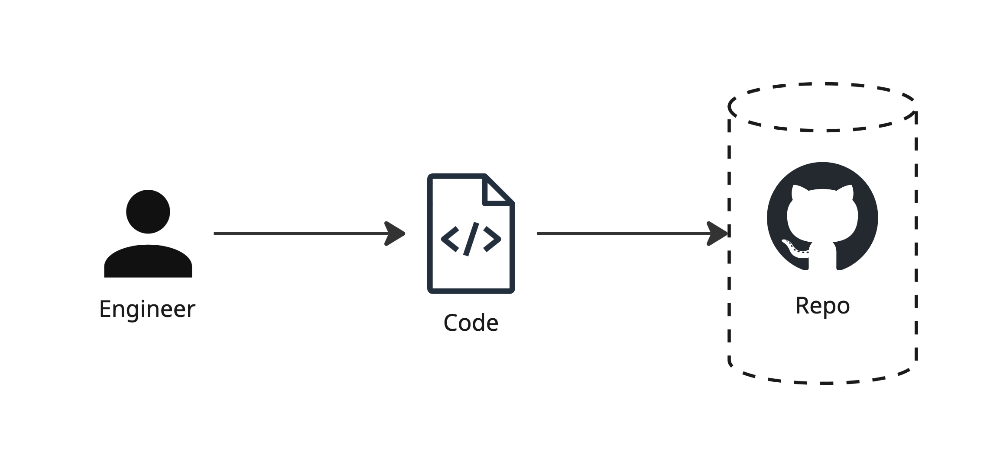

An oversimplification, sure. But a first principle is not the whole picture, it's the part that's true no matter what you strip away. Strip engineering all the way down and it's two steps, solve problems by writing code and share that code. Everything else is a decoration.

In practice, that decoration is most of the job. The loop grows steps around the core: plan the change, write it, test it, review it, merge it, ship it, watch it in production, then start over the moment something breaks or something new needs building. That longer loop has a name. It's called the software development lifecycle, and it's where the real bottlenecks live.

### The Software Development Lifecycle

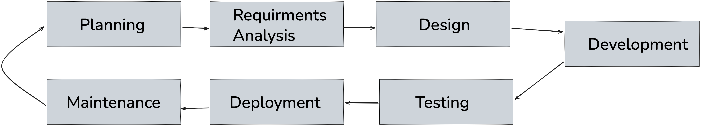

The lifecycle itself is not the problem, the loop is fine, it's been fine for decades. The problem is that each of those seven boxes is actually a bundle of a dozen smaller workflows wearing one label, writing tests versus running them, documentation versus code, a hotfix versus a rewrite. Seven boxes was always a map, but a engineer fills the gaps with judgment without noticing agents can't, not until someone breaks each box down into the workflows actually living inside it.

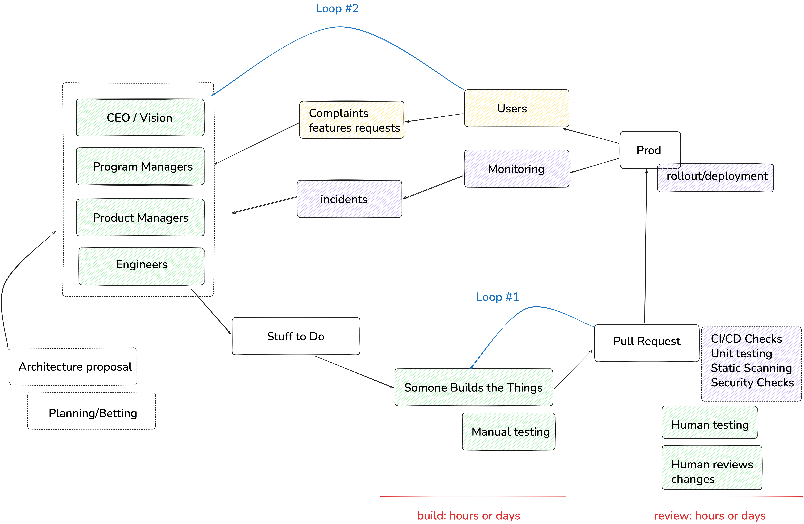

This lifecycle is not even the entire picture, this just shows you that those original boxes, in a production setting, turn into a whole intricate and complicated set of workflows.


### Scaling the SDL to a Global Data Platform

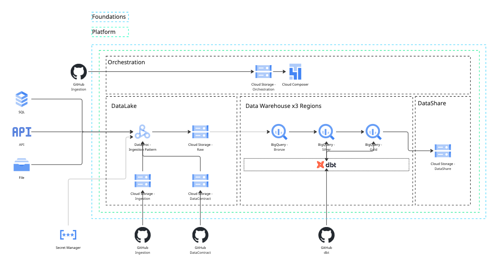

Credeq's global data platform is multiple repositories, and each one runs its own version of that lifecycle, at its own pace, bottlenecked in its own place, for its own reasons.

- **dbt Region** — dbt modules and transformation logic for a specified region
- **Data Platform Foundations** — the infrastructure as code underneath all of it
- **Data Platform** — the modules that build up the data warehouse itself
- **Data Orchestration** — the Airflow DAGs that keep everything running on schedule
- **Data Contracts** — the contracts that govern what's allowed in from ingestion sources

A slow step in dbt Africa isn't the same bottleneck as a slow step in Data Contracts. Before anyone reaches for an agent: define each of these lifecycles on its own terms, and break each one down to the workflow level.

Each lifecycle decomposes into a set of workflows, and that decomposition is what actually shows engineers where the bottlenecks are, and where tooling would strategically help remove them. That's the real unit of granularity, not the lifecycle, and not the repo, the workflow underneath both of them.

Do the decomposition honestly and the workflows sort themselves into two kinds. Most of them stay home. A new model in dbt Africa gets planned, written, tested, and shipped without ever leaving that repo. **Local workflows**, local bottleneck, local fix.

Some workflows don't respect the walls of the house. A new field from an ingestion source starts as a change in Data Contracts, gets picked up by Data Orchestration, lands in the warehouse through Data Platform, and only becomes real once a dbt region transforms it. One workflow, four repos, four owners, and nobody who can see the whole thing from where they're standing. That's a **cross-repo workflow**, and it fails differently than a local one. Not inside a repo, in the handoffs between repos.

Multiple lifecycles, each hiding multiple workflows, some local to a single repo, some stretched across all of them at once. One shared skill file, or one shared agent, can't see this picture, averaging that many different bottlenecks into a single view is how you end up fixing none of them. Hold onto the local-versus-cross-repo distinction, it comes back when the framework has to survive contact with both.

## Problem Statement

Putting the problem statement into words.

**Scale Credeq's developer operations with AI agents, without compromising on quality, while increasing engineering velocity.**

Three things in one sentence, and each one can quietly kill the other two. Scale carelessly and quality erodes. Chase velocity and the repos closest to launch cut corners the others won't. Protect quality by slowing everything down and you've just renamed the problem, not solved it. This is the same trade from earlier, speed, quality and cost.

An AI agent is just another tool, not a strategy, but also not quite tha same category as a linter or a CI pipeline. Yet the tool is only as good as the **bottleneck** it gets pointed at. Aim it at nothing in particular and it's just an expensive way to feel busy.

"Real tools get treated like tools". Nobody installs a linter without knowing exactly what it's not allowed to break. Nobody keeps a CI pipeline that can't show you what it caught. A tool earns its place **twice**, once before it goes in, checked against the constraints, and once after, against a number somebody actually reads. Agents don't get an exemption because they can talk or use stats to "reason".

### Problem Statement Components

What the problem statement is actually made of, the moving parts that everything above was building toward.

- **Engineers** — the people whose judgment decides which tool gets used, where, and whether an agent belongs in the loop at all.
- **Tool usage** — agents, CI, cli tools... anything that turns judgment into leverage.
- **Processes** — the workflows, global and local, that all of this actually has to run inside.

### Problem Statement Constraints

What the solution isn't allowed to sacrifice to get there.

- **Quality** cannot be compromised.
- **Speed** should increase.
- **Cost** should be minimized.

These aren't three rules of the same kind. Quality and cost are gates, you check them going in, and a violation vetoes the agent. Speed can function as a scoreboard you check it coming out, to see if the whole implementation paid off. Gates before, scoreboard after, mix them up and you get agents that are very fast at making things worse.

## An Agent Is Just an Application

### Agent explanation

Google's [architecture guidance](https://docs.cloud.google.com/architecture/choose-agentic-ai-architecture-components) defines an agent as an application that achieves a goal by processing input, performing reasoning with available tools, and taking actions. Read it twice, because the word doing the work is *application*. Not a colleague, not a strategy, an application with a model sitting where the business logic used to sit. The reasoning is new. The rest is the same anatomy every tool has, inputs it accepts, tools it's allowed to touch, and a goal somebody defined.

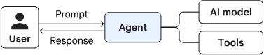

### Design patterns to note

#### Orchestrator pattern

Google calls this the [coordinator pattern](https://docs.cloud.google.com/architecture/choose-design-pattern-agentic-ai-system), one central agent takes the request, breaks it into sub-tasks, and dispatches each piece to a specialized agent. The coordinator doesn't do the work. It routes the work. That's useful precisely when the routing itself needs judgment, which is what a cross-repo workflow looks like from the outside.
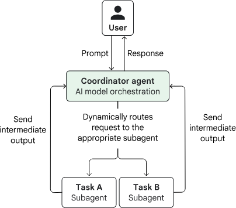

Its stricter cousin is the **multi-agent sequential pattern**. This pattern includes specialized agents in a fixed order, each one's output becoming the next one's input. Google's guidance recommends it for highly structured, repeatable processes, and the example they reach for is data pipelines.

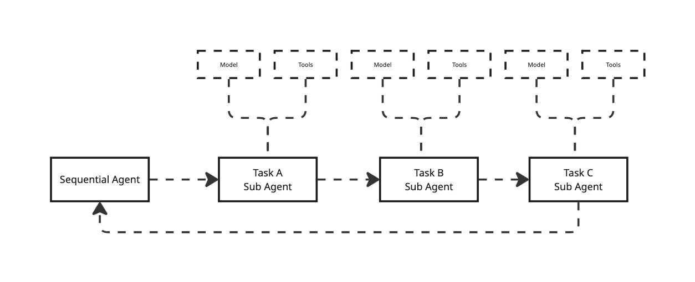

#### Hyper-specific single agent

This is Google's single-agent system with the scope turned all the way down: one model, a defined set of tools, a system prompt that covers one workflow and nothing else. Small enough to reason about, cheap enough to run, and it sidesteps the failure mode Google names [tool bloat](https://docs.cloud.google.com/architecture/choose-agentic-ai-architecture-components), tool definitions piling up in a system prompt until the model gets less accurate and more expensive at the same time. In a shared agent, every rule added for one repo is noise every other workflow has to pay for. Decomposing isn't a style preference. It's how the quality gate stays closed.

Two things follow, and they're easy to confuse. The **framework** is the *decision* — whether an agent belongs and where — and it can answer no. The **architecture** is the *build* — what you actually stand up, but only for the workflows the framework didn't already reject. Framework first, because there's no point designing a system for an agent that shouldn't exist.

## The Framework

Everything above collapses into three steps. Run them in order, every time, for every agent, and the judgment becomes a procedure anyone can run, not a call only the seniors can make

1. **Identify the SDL.** Which lifecycle are you standing in, and is it local to one repo or global to the platform.
2. **Identify the workflow.** Not the box on the diagram, the actual workflow living inside it.
3. **Check the gates.** Check the gates. Verify an agent at that exact point violates neither the cost nor the quality gate, speed comes later, on the scoreboard. If it violates one, stop. **No is a fine answer.**

These aren't house rules. Google's own [guidance on choosing agent design patterns](https://docs.cloud.google.com/architecture/choose-design-pattern-agentic-ai-system) starts from the same axes, the shape of the task, the cost budget, how much human oversight the job demands, before any pattern gets picked.

## The Proposed Architecture

The architecture is two tiers, and they map directly onto the local-versus-cross-repo distinction from earlier, **distribute the knowledge, centralize only the routing.** By default the specialists aren't standalone agents at all, they're **skill files colocated in the repos they serve**, each carrying only its own repo's scar tissue(logic) and versioned alongside the code it acts on.Execution happens in a coordinator, which does one thing, it routes.

Locally, a repo-local coordinator routes among a repo's own skills, however across repos, a central coordinator invokes each repo's skills in handoff order. Either way the coordinator knows nothing about the domain. It routes; the skills know how. Never the reverse.

**The coordinator succeeds not by knowing things, but by knowing who does.**

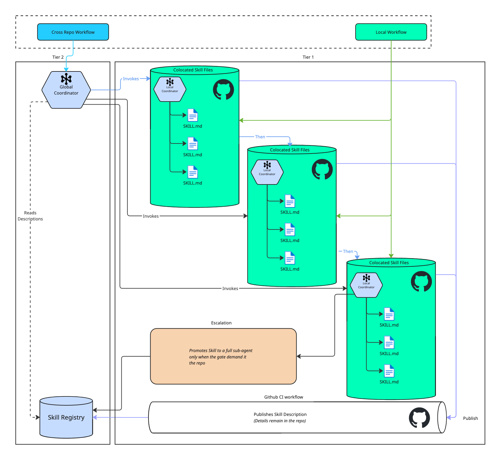

A **local workflow** (green) is handled entirely inside its repo, its own coordinator invoking its own skills, no central hop, which keeps the common case cheap. A **cross-repo workflow** (blue) hits the central coordinator, which reads the skill registry and invokes the colocated skills that own the domain knowledge, in handoff order.

The registry doesn't fill itself, and it isn't filled by hand. The purple path is how a repo surfaces a skill, on merge, a CI step publishes *only that skill's description* to the central registry, never its body. The knowledge stays in the repo while the "pointer" travels. Two things fall out of that. 
- The registry is current the instant a PR lands. 
- Governance is free, it rides on the same CODEOWNERS review that already gates the code. 

With this the thesis holds literally, **distribute the knowledge, centralize only the routing metadata**. The orange is a *different* axis and shouldn't be confused with registration. Escalation changes what a skill **runs as**, a full sub-agent, only when a gate demands something a file can't give. Registration changes how a skill is **found**. One is about runtime, the other about discovery.

### Do the Specialists Need to Be Agents? Skills as the Default

A skill isn't an agent. An agent is an application with its own model, tools, and reasoning loop. A skill is passive knowledge, a file that gets loaded into a running agent's context when it's invoked, and does nothing on its own. So Tier 1 isn't really "agents living in repos." It's knowledge files living in repos, plus one host agent that loads the right one at the right time. The knowledge stays distributed; the execution centralizes into the host. That's the thesis.

Framed as skills, most of the argument gets *stronger*. **Ownership and colocation** stop being aspirations.A skill is just a markdown file in the repo, versioned with the code, reviewed in the same PR, owned by the same CODEOWNERS, with no separate service to deploy or secure. **The registry comes for free**, it's just the set of skill descriptions the host can see. Discoverability isn't something we have to build, it's something we already have. And **the cost gate holds through progressive disclosure**. Progresive Disclosure allows the one-line description to stay in context cheaply, the body loads only on invocation, so only the relevant repo's rules ever enter the prompt. That last one has a condition attached, and it matters, the win holds only if skills are *invoked*, not preloaded. Concatenate every repo's skill into one always-on prompt and you've quietly rebuilt the shared mega-agent this whole document argues against.

Two guarantees get *weaker*, and the honest move is to name them rather than let them leak. **Isolation** is the first. Separate agents each run with their own tool permissions, a hard sandbox. Skills all load into the same host's context and share its tool access, so "a narrow specialist can't confidently wander into another repo" stops being an architectural wall and becomes a matter of selective invocation plus a harness that enforces per-skill tool allowlists. If the runtime doesn't scope tools per skill, that guarantee is just a prompt asking nicely. **Independent per-stage execution** is the second. With full agents the handoff is agent-to-agent, and each stage can carry its own model, permissions, and failure domain. With skills the handoff is one host swapping files in sequence, which is fine for the strictly sequential pipeline Credeq actually runs, but it buys no parallelism and no independent failure between stages.

So the rule is, **default to skills, promote to a full sub-agent only where a gate demands it**, its own tools, real parallelism, or independent failure isolation. That's the same "no is a fine answer" discipline from the framework, pointed at the runtime instead of the workflow: don't stand up an agent where a file does the job.

### Composing New Agents From the Registry

Once every skill is discoverable by description, the registry stops being just a routing table and becomes a **menu you compose from**. Defining a new agent no longer means authoring new knowledge. It means three cheap things: 
- Pick a subset of skills from the registry 
- Write a system prompt that states the goal
- Declare a tool allowlist. 

The knowledge already exists, owned and versioned in the repos that wrote it. The new agent is a *selection over the registry*, not a new body of rules.

Two properties keep this honest. **The registry is the allowlist.** You can only compose from skills that were published through a PR, so every agent is assembled from reviewed, owned building blocks, there's no back door that skips governance. And **composition doesn't exempt you from the framework.** Being *able* to snap five skills together doesn't mean an agent belongs there. The three steps still run, and the gates still get a veto. Composition makes agents cheap to propose, which is exactly why the gates matter more, not less, the easier it gets to assemble one, the more the discipline has to live in deciding whether to. Note the difference from escalation one more time escalation promotes a single skill into its own runtime. Composition assembles many skills into one agent's context. Building blocks, not a promotion.

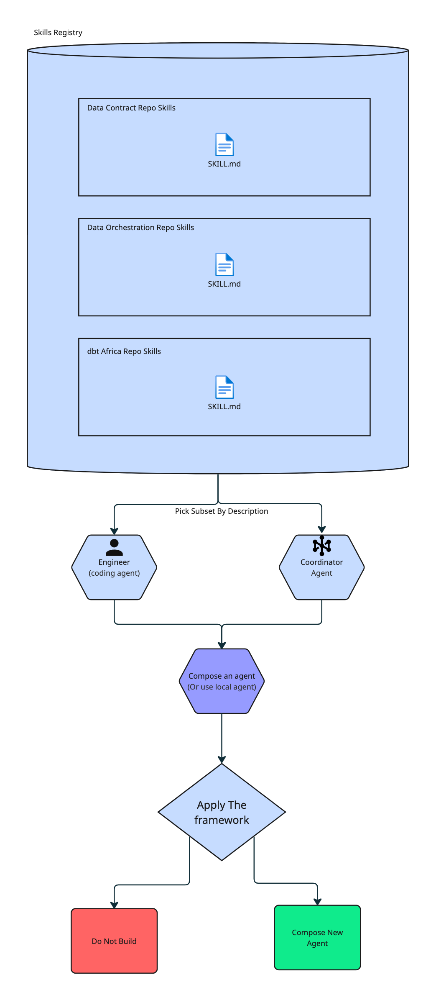

### The Architecture on GCP

The two-tier design maps cleanly onto GCP services, and the mapping is what makes "distribute the knowledge, centralize only the routing" concrete rather than aspirational. Knowledge stays in the repos; one central runtime executes; everything the agent actually touches is already a GCP-managed service Credeq runs today.

| Concept | GCP service | Why |
|---|---|---|
| Skill (knowledge), colocated | repo — GitHub | versioned and governed with the code it describes |
| Publish on merge | **Github Actions** trigger per repo | registration rides the existing CI, no manual step |
| Registry — descriptions + pointers | **Firestore** | cheap structured lookups the coordinator reads to route |
| Skill bundles — derived artifacts | **Artifact Registry** (or GCS) | host loads a built bundle, never clones repos at runtime |
| Host + coordinator runtime | **Cloud Run** | one service, scales to zero, one thing to deploy and secure |
| Reasoning / model | **Vertex AI** — Gemini, or Claude via Model Garden | managed inference, IAM-scoped, no key sprawl |
| Async triggers (Slack bug, ingestion) | **Pub/Sub** + webhook on Cloud Run | decouples the trigger from the run, gives retries |
| Secrets (tokens, model keys) | **Secret Manager** | no credentials baked into skills or images |
| Per-skill tool scoping | **IAM** service accounts / Workload Identity | the tool allowlist becomes a hard boundary, not a prompt |
| Open PRs | GitHub API | the agent hands back at the PR, as designed |
| Trigger DAGs | **Cloud Composer** (managed Airflow) | the DAG steps stay where they already live |
| Build / compare data | **BigQuery** | dbt targets and legacy comparisons run in-warehouse |
| Scoreboard — speed, gate verdicts | **Cloud Logging / Monitoring / Trace** | the "read it after it ships" number, instrumented |
| Escalated sub-agent | dedicated **Cloud Run** service + own IAM | independent runtime and sandbox, only when a gate demands |

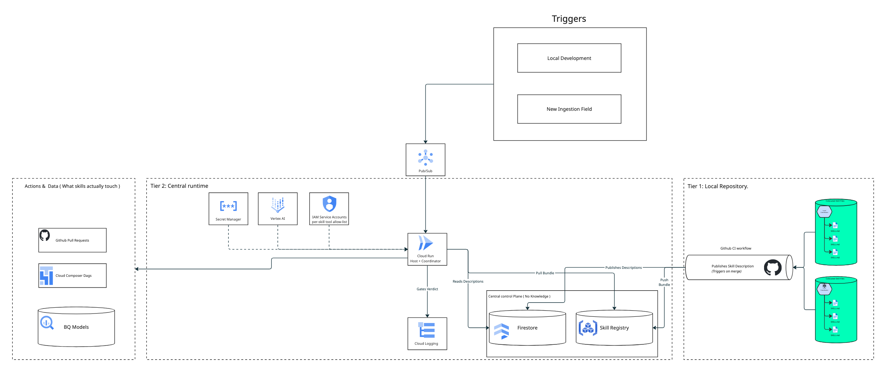

**A local workflow** (dbt dimension) never touches the central plane. The repo-local coordinator runs inside the dbt Region repo's own CI, loads its own skills, acts on BigQuery, and opens a PR. Cheap common case, no central hop.

**A cross-repo workflow** (Slack production bug) posts an event to **Pub/Sub**, which wakes the **Cloud Run** host. The host reads **Firestore** to match the bug against skill descriptions, loads the relevant bundles from **Artifact Registry**, reasons over them with **Vertex AI**, and dispatches to the colocated skills in handoff order, opening PRs via the GitHub API and triggering the right DAG in **Cloud Composer**. Every action runs under a per-skill **IAM** service account, so a skill can only touch what its allowlist grants.

Two GCP details do real work for the framework. **IAM per service account** turns the quality gate's "a narrow specialist can't wander into another repo" from a prompt-level hope into an enforced boundary, the skill physically cannot call what it isn't granted. And **Cloud Logging / Monitoring** is where the speed constraint stops being a claim: gate verdicts and cycle-time deltas get recorded, so "read the scoreboard after it ships" has an actual dashboard behind it. If hand-rolling the host on Cloud Run is more than you want to own, **Vertex AI Agent Engine** is the managed alternative for the runtime tier, the same split still holds, only the host's hosting changes.

### How it addresses speed

Speed is the one the framework reads *after*, the scoreboard rather than a gate, so the architecture earns it in concrete ways instead of claiming it. 

First, it aims the agent at the actual bottleneck, the scaffolding an engineer rebuilds for every model (Bronze and Silver configs, dedup, SCD, mapping), so the number that moves is time-to-PR for a new dimension, hands-on minutes traded for review minutes.

Second, the common case has no central hop, a local workflow goes straight to its repo's coordinator, so the frequent path pays no routing latency at all.

Third, work that used to serialize through one overloaded engineer, or one oversized agent, can run in parallel, independent repo agents and sub-agents proceeding concurrently wherever a handoff allows. And because the skill is already colocated, none of that speed is spent re-discovering the repo's scar tissue, the knowledge is in context the moment the agent starts. Whether it actually paid off isn't a matter of faith, it's the cycle-time delta on the Cloud Logging dashboard, read after it ships.

### How it maintains quality

Narrow scope does most of the work here, an agent that only knows one workflow can't confidently wander into someone else's. For the rest, Google's [review-and-critique pattern](https://docs.cloud.google.com/architecture/choose-design-pattern-agentic-ai-system) pairs the generator with a critic that evaluates the output against criteria and approves it, rejects it, or sends it back. That's the quality gate kept running in production. 

### How it reduces cost

Google's pattern guidance is blunt about the cost driving model calls. Cost scales with how many calls a pattern makes and how much context each call drags along. A hyper-specific agent keeps both small, a lean prompt, no tool bloat tax, no reasoning through five repos' worth of rules to answer a question about one. That saving lands on every single invocation, which is the kind that compounds quietly.

## Appendix — Reference Architecture: Hyper-Specialized Colocated Repo Agents

The research above makes the case, this appendix is the informal reference architecture for the system it argues for, the spec an engineer would actually build from. It restates the core ideas in rigorous form and adds the parts a production agentic system can't ship without: the skill contract, security and trust boundaries, guardrails, evaluation, cost control, versioning, the decision log, and the risks. The GCP service mapping earlier in *The Proposed Architecture* is the concrete deployment target for the structure described here.

*Reference architecture for the agents on Credeq's global data platform: what it is, how it rolls out, and how it stays bounded, cheap, and correct in production.*

> **How to read this.** §1–4 set the frame (context, stakeholders, constraints, quality). §5–7 are the architecture (principle, rollout, structure, runtime). §8 is the load-bearing half for an agentic system — the skill contract, security, guardrails, evaluation, cost, and the rest. §9–15 record trade-offs, decisions, risks, and terms.

---

## 5. Core Principle

**Distribute the knowledge, centralize only the routing.**

One rule decides everything: *the repo is the agent boundary.* Not one platform-wide agent that knows every repo (it averages every bottleneck into one and pays a tool-bloat tax on every call), and not a loose pile of skills with no runtime. One agent per repo, carrying only that repo's scar tissue, behind a central coordinator that routes but knows nothing.

| Level | Unit | Role | Holds domain knowledge? |
|---|---|---|---|
| Platform | **Central coordinator** | Routes cross-repo work to the repo that owns it | No — routing only |
| Repo | **Repo agent** | Isolation + runtime boundary; one per repo | Yes — only its own repo's |
| Inside the repo | **Skills → hyper-specific sub-agents/local coding agents** | Keep the repo agent lean; invoked/spun up selectively | Yes — one narrow slice each |

The invariant that must survive to the end, **at any moment, only the knowledge a given request actually needs is in context.** The day "fully automated" means "everything loaded at once," the cost and quality gates both fail.

## 6. The Two-Step Rollout

The architecture is built in the order that delivers value first and locks in the least.

### Step 1 — Capture every local workflow as a `skill.md`

Before any agent exists, go repo by repo and write down the local workflows — those that start and finish inside a single repo — each as its own skill file:

- One skill per workflow, not one skill per repo. A skill covers *one* thing (e.g. "build a Silver-layer model," "build a conformed dimension") and nothing else.
- The skill file lives **in the repo it serves**, versioned with the code, reviewed in the same PR, owned by the same CODEOWNERS.
- Each skill carries only its own slice of scar tissue: the configs, conventions, and the one rule nobody wrote down because everyone just knew.

Step 1 pays off **on its own, with no agent attached** — documentation, onboarding, and a machine-readable map of where the work is. You never hold a half-built system that does nothing until it's finished.

### Step 2 — Give each repo an agent that spins up hyper-specific sub-agents

Once a repo's workflows are skills, add **one agent for that repo.** It's not a bucket that swallows every skill at once — it's a coordinator that, per request, **spins up a sub-agent scoped to exactly the skill(s) needed** and nothing else.

- The repo agent holds **no domain knowledge of its own.** It knows which skill owns what, and in what order to run them.
- Each sub-agent runs on a **lean prompt** — one skill's rules, one narrow tool set — so no sub-agent pays for another's context.
- The repo agent is the **isolation boundary**: its sub-agents run with tool permissions scoped to that repo.

Cross-repo workflows are the only case a single repo agent can't see. Those go up to the **central coordinator**, which routes to each repo agent in handoff order.

## 7. Building Block & Runtime Views

### 7.1 Architecture at a glance (static structure)

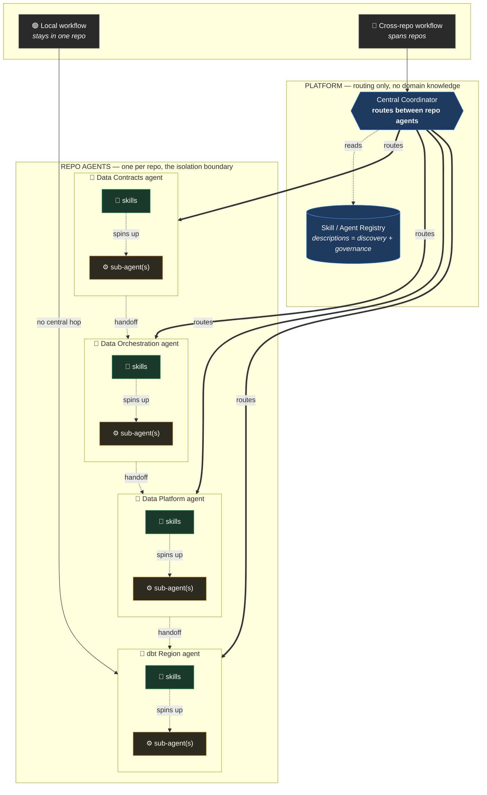

### 7.2 The two-step rollout, visualized

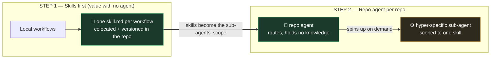

### 7.3 Runtime view — a cross-repo workflow (Slack production bug)

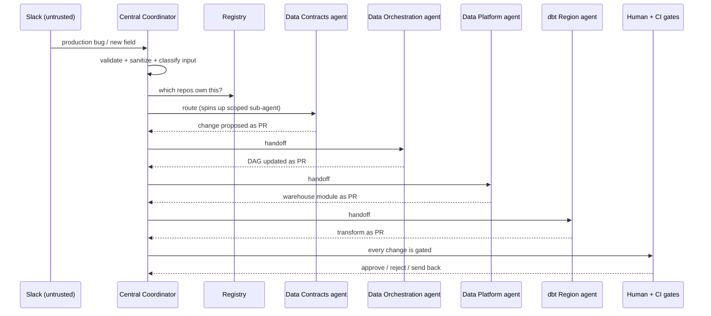

### 7.4 Capability Discovery — how the orchestrator knows what each repo can do

The orchestrator holds no domain knowledge, so it learns what each repo *can do* without absorbing how it works — through the **registry**. Each skill advertises a one-line capability (`name` + `description`); those are collected centrally; the orchestrator routes on the descriptions alone. Knowledge stays distributed, only discovery is centralized.

The flow runs top-down — orchestrator, to registry, to repo agents, to skills, to the sub-agents that do the work:

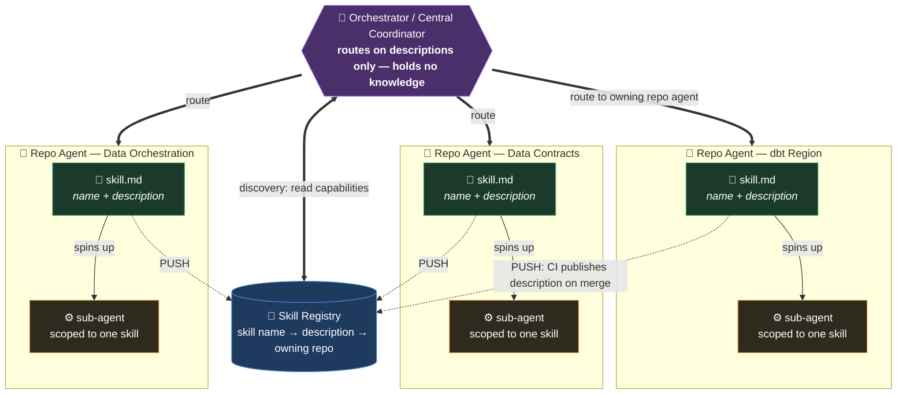

**Descriptions drive routing; the tagged file is what ships.** The registry holds two things per skill: the *name → description → owning repo* triple used for routing, and the versioned skill file itself as a tagged artifact. The orchestrator matches a request against the one-line descriptions, picks the owning repo agent, then **pulls the skill it needs from the registry** — latest tag by default, a pinned version when reproducibility matters — rather than reaching into the repo at runtime. The repo agent still executes and spins up the sub-agent locally; what changed is *where the file comes from*: the registry, at a known version, not the repo's current HEAD. How skills get into the registry and how versions get pulled is §8.12.

#### Push vs. Pull — keeping the registry current

The registry is only useful if it reflects what the repos can do *right now*. Two ways to keep it in sync, and it's a genuine trade-off:

| | **Push** (recommended default) | **Pull** |
|---|---|---|
| **Who updates it** | The repo's CI publishes its skill descriptions to the registry on merge | The orchestrator scans each repo's skill files on demand |
| **Freshness** | Always current — updates in the same PR that changes the skill | Current only as of the last scan |
| **Drift risk** | Near zero — capability and advertisement move together | Possible between scans; a stale cache misroutes |
| **Cost / latency** | Paid once at merge, off the hot path | Paid at request time, on the hot path |
| **Coupling** | Repo must know how to publish | Orchestrator must know how to reach every repo |

**Push-on-merge is the default:** the registry updates in the same PR that changes the skill, so the advertisement can't drift and discovery stays off the hot path. **Pull** is the fallback where a repo can't publish (no CI hook, external repo). The robust option is **hybrid** — push as primary, with a periodic pull to reconcile anything that failed to publish.

That table is about keeping the *descriptions* fresh. The skill *files* ride the same round-trip but with versions attached — the repo pushes a tagged file on release, the coordinator pulls a version on use — which is the release model spelled out in §8.12.

---

## 8. Cross-Cutting Concerns

Everything below exists only because the system is a **non-deterministic actor that reads untrusted input, wields tools against production data, costs money per step, and can loop, hallucinate, or be hijacked.** A generic microservice wouldn't need these sections; this one can't ship without them.

### 8.1 The Skill Contract & Scoping Model

The skill is the system's distinctive primitive. Every `skill.md` declares a contract in frontmatter, and a sub-agent is scoped to exactly one skill — nothing more enters its context. That *is* the tool-bloat mitigation: each sub-agent sees only its own skill's tools.

```markdown
---
name: build-conformed-dimension
description: Build one conformed dimension end-to-end from Silver models  # used for routing + registry
owner: "@dbt-region-team"          # CODEOWNERS
version: 1.4.0                       # SemVer (see §8.10)
repo: dbt-region
tools: [dbt_build, dbt_validate, read_repo]   # allowlist — the sub-agent gets ONLY these
permissions: read-write              # read-only | read-write (write triggers §8.4 gates)
preconditions: "source-to-target mapping and grain are settled"
postconditions: "hands back at the PR once dbt validate/build is green"
stopping_condition: "max 8 tool iterations OR dbt build green"   # required (see §8.3)
answers_to_gates: [dbt_validate, peer_review, legacy_comparison]  # external checks it does not own
promote_to_subagent_when: "needs its own sandbox, parallelism, or independent failure"
---
```

**Rule:** a skill with no declared `tools`, `permissions`, and `stopping_condition` does not ship. The contract is what makes scoping enforceable rather than aspirational.

### 8.2 Security & Trust Boundaries

The highest-consequence section, because agents act on production data.

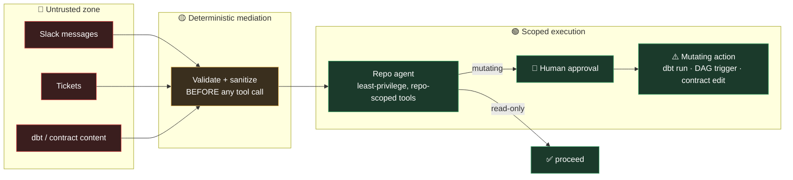

- **Untrusted input.** Slack messages, tickets, dbt model contents, and contract payloads are untrusted. They are validated and sanitized by deterministic code *before* any tool fires — never fed straight into a tool call.
- **Least privilege / confused-deputy.** Each repo agent and sub-agent holds only the permissions its scope needs, scoped down on completion. A successful prompt injection then still hits a permission wall — it cannot reach another repo.
- **Read vs. mutating.** Every skill declares which. Read-only work proceeds; mutating work (`dbt run`, DAG trigger, contract edit) routes through the §8.4 human gate.
- **Secrets.** Short-lived, user-scoped tokens; no long-lived credentials in a skill's context; sandboxed execution for anything that writes.

### 8.3 Guardrails & Stopping Conditions

- **Layered validation.** Pre-tool guardrails (schema-valid, PII-screened, injection-screened inputs) and post-tool guardrails (output quality, action validation before a mutating tool fires).
- **Critic / evaluator.** For high-accuracy outputs, pair the generator with a critic that approves, rejects, or sends back — the review-and-critique pattern, kept running in production, not just checked once at the door.
- **Runaway prevention.** Every skill declares a stopping condition (max iterations, token/step budget). Without one, a loop can run indefinitely and cost is the only symptom.
- **Retry-then-fallback.** Two retries with increasingly specific instructions; on the third failure, return a canned fallback and log the incident for a human.

### 8.4 Human-in-the-Loop Gates

Named, concrete actions that require a human to sign off *before* execution:

- Modifying a **data contract**.
- Deploying a **dbt model change to production**.
- Triggering a **production DAG**.
- Any **irreversible or destructive** operation.

The approval surface lives in Slack (or the PR), a paused run persists its state (§8.9) and resumes on approval. Everything the framework leaves to humans and CI — PR review, DAG triggers, the two legacy comparisons — stays there by design. The agent produces; it never marks its own homework.

### 8.5 Evaluation & Testing

The agent equivalent of a test suite, and *the* mechanism that makes editing a skill file safe.

- **Golden datasets per skill** — versioned, human-validated representative inputs with trusted expected outputs, grown from real failures. Never let an agent write its own ground truth.
- **LLM-as-judge** with explicit rubrics, pinned to a *different* model family than production (or subjective scores inflate).
- **Trajectory evaluation** — score the steps taken, not just the final answer (did it pick the right skill, in the right order, with the right tools).
- **Regression gate in CI** — a fast replay suite that blocks a skill-file merge if any metric drops below threshold. A skill change that fails its evals does not deploy.

### 8.6 Observability, Tracing & Cost Accounting

You cannot debug a multi-agent run you can't see. The coordinator → repo agent → sub-agent path is a **nested call tree**, so a flat log won't do.

- **Distributed tracing** (OpenTelemetry GenAI conventions): each tool call, model invocation, and retrieval is a child span; child sessions link back to the parent's tool-call span.
- **Cost/latency per span**, attributed to agent and workflow. Cost is the canonical anomaly signal: a run using 50k tokens for a 3k-token job is probably stuck in a loop (§8.3).
- **Reasoning trace** captured for every action — tool selection and execution path — so a bad output can be diagnosed, not just observed.

### 8.7 Model Selection, Routing & Budgets

Model tier is a first-class architectural decision, not an implementation detail.

- **Routing / cascade.** The coordinator runs on a cheap, fast routing model (a routing decision carries no domain context). Sub-agents are tiered by task complexity: simple scaffolding on a cheaper tier, hard judgment on a frontier tier, with escalation-on-failure.
- **Prompt caching.** Skill markdown is a stable, cacheable prefix — a large, cheap win on every invocation of that skill.
- **Budgets.** Per-run and per-tenant token budgets with hard caps, tied to the stopping conditions in §8.3.

### 8.8 Failure Modes, Fallbacks & Idempotency

- **Retries** with exponential backoff + jitter; unregulated retries risk duplicated work and cascading failure.
- **Idempotency keys** on every mutating action so a retried `dbt run` / DAG trigger / write does not double-execute — essential on a data platform.
- **Compensating transactions** to roll back to a known-good state; **circuit breakers** to isolate a malfunctioning repo agent.
- **Graceful degradation** — the coordinator falls back to a narrower skill or a human handoff when a repo agent is down, rather than failing the whole workflow.
- **Durable execution** so retries and paused human-gates survive process restarts.

### 8.9 State, Memory & Handoff

- **Short-term scratchpad** — checkpointed session state within a single run.
- **Shared context store** — durable business context agents query before acting (Firestore / Cloud SQL / equivalent, not in-memory).
- **Handoff record** — the coordinator passes *only what the next agent needs*, never the whole conversation; context bloat is a cost and a quality risk.
- **Source of truth** — the data contract and dbt manifest are authoritative, not an agent's memory. Agents read the source of truth; they don't become it.

### 8.10 Versioning & Change Management

Skills change often, so they are versioned, governed artifacts — not config.

- **SemVer per skill** (major/minor/patch across prompt, tool schema, execution logic).
- **Backward compatibility** for skills the coordinator routes to; breaking a skill's contract is a major bump with a migration path.
- **Independent rollback** — revert one skill version without touching the rest.
- Every change flows through the §8.5 eval/regression gate before deploy.

### 8.11 Governance, Registry & Audit

- **Registry** — the catalog of every agent and skill; its descriptions are what let the coordinator discover and route (see §7.4 for the discovery flow and the push/pull sync model). It also stores the versioned skill *files* themselves (§8.12), so the routing metadata and the artifact that actually runs live in one governed place. Discoverability falls out of writing skills.
- **Ownership** — who owns each repo agent and skill (CODEOWNERS), with quality gates on changes.
- **Audit trail** — which agent used which skill *version*, with what inputs, producing what side effects. Both an operational aid and a compliance requirement.

### 8.12 Skill Release, Tagging & Distribution

Skills are managed like code: **tagged, pushed, pulled.** The registry isn't only the description catalogue of §7.4 and §8.11 — it's the versioned store the skill files live in once released, and it's the one surface the coordinator reads from at runtime.

- **Release is an explicit tag, not every merge.** A skill is canonical in its repo. When a change is ready to go live, the repo's CI tags it (SemVer, §8.10) and **pushes the whole skill file** — frontmatter *and* body — to the registry under that tag. Tags are immutable: a new release is a new tag, never an overwrite of an old one, so a version that ever ran can always be reproduced. Governance rides the same PR and CODEOWNERS review that approved the code (§8.11).
- **Distribution is a pull.** At use time the coordinator **pulls the skill from the registry** — the latest tag by default, or a pinned version when a workflow needs to be reproducible. It never reaches into the repo at runtime, so it's decoupled from branch state, repo availability, and repo access. The registry is the single surface it talks to.
- **Why tags beat "latest on `main`".** A tagged pull is byte-for-byte reproducible; rollback is just pulling the previous tag, with no repo change (§8.10); and the audit trail (§8.11) can record exactly which skill *version* ran, not "whatever `main` happened to be that day."

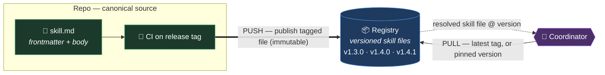

This is the push/pull of §7.4 made concrete and given versions: **push on release** keeps the registry authoritative, **pull on use** means the coordinator always resolves a *known* version. Description sync and file distribution are the same round-trip — the description is simply the slice of the pushed file the coordinator reads to route, before it pulls the rest to execute.

---

## 9. Benefits

- **Incremental payoff — value before any agent exists.** Step 1 alone gives documented, machine-readable workflows and a map of where the real work is.
- **Ownership and colocation are automatic.** A skill is a file in the repo — versioned with the code, reviewed in the same PR, owned by the same CODEOWNERS. Rule and code can't silently drift apart.
- **Isolation is a hard wall, not a polite request.** Because the *repo* is the agent boundary, every sub-agent runs with repo-scoped permissions. A specialist can't wander into another repo — the sandbox enforces it.
- **Cost stays lean on every invocation.** Progressive disclosure loads only the relevant skill. No sub-agent reasons through five repos' — or even two skills' — worth of rules to do one job. The common case stays cheap, and that compounds.
- **The quality gate stays external.** The agent produces; humans and CI veto. No agent marks its own homework.
- **The registry comes for free.** The set of skill descriptions *is* the catalogue.
- **It scales the way the org scales.** New repo → add one agent. New workflow → add one skill. Nothing existing gets rewritten; no shared prompt gets heavier.
- **Parallelism across repos.** Independent repo agents can run concurrently where the handoff allows, instead of one giant agent serializing everything.
- **No single point of *knowledge*.** The coordinator routes but knows nothing — no one prompt has to understand the whole platform.

## 10. Limitations

- **Cross-repo coordination must be designed, not assumed.** Sequential handoffs and evaluators are patterns you build; making a repo agent bigger doesn't produce coordination.
- **Isolation *between sub-agents in the same repo* is soft.** The hard wall is the repo boundary; inside a repo, scoping relies on selective invocation and harness-enforced allowlists.
- **The cost win is conditional on selective invocation.** Preload a repo's skills into one prompt and you've rebuilt the mega-agent inside a single repo.
- **It assumes harness support.** Scoped sub-agents and per-skill tool allowlists depend on the runtime; without it, per-skill isolation is convention, not guarantee.
- **The central coordinator is a routing single point.** It holds no knowledge, but a misroute sends cross-repo work to the wrong repo agent. Routing correctness is itself a gate.

## 11. Drawbacks

- **Upfront decomposition is real work.** Writing every local workflow as a well-scoped skill is a genuine investment before Step 2 returns anything.
- **Skills drift if unmaintained.** A skill not updated with its code becomes confidently wrong. Colocation makes drift *visible* in review; it doesn't prevent it.
- **More moving parts than one agent.** A coordinator, N repo agents, and many skills is more surface to build, monitor, and reason about.
- **Routing and multi-hop latency.** Cross-repo work pays for a routing call and several sequential hops — small per call, but it grows with the chain.
- **Governance spread across repos.** Auditing "what can act, and where" is a cross-repo exercise; the registry mitigates but doesn't erase it.
- **Not everything deserves an agent.** Triggering a DAG or merging a release is work a GitHub workflow already does for near-nothing; pointing an agent at it is a cost-gate violation.

## 12. The Escalation Rule

Default to the cheapest thing that clears the gates, and promote only when forced:

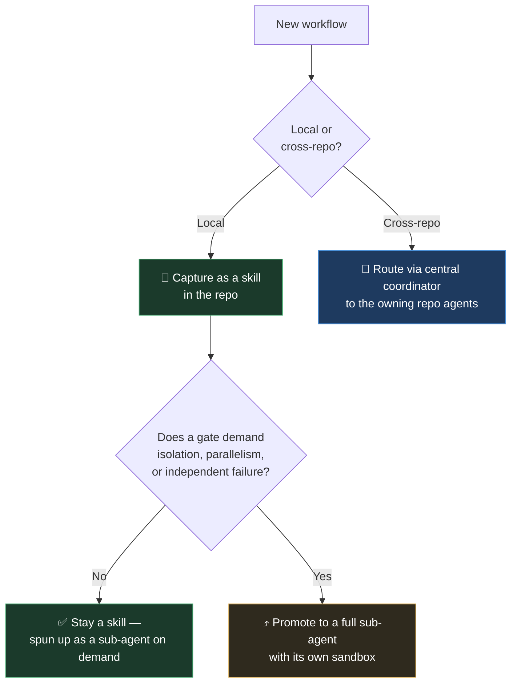

Skills stay distributed and separate; the repo agent ties them together at runtime by **invoking and spinning up**, never by merging. The endpoint is a *fleet* of narrow specialists behind routers — not one omniscient agent.

## 13. Architecture Decisions (ADR Log)

Immutable once accepted; supersede rather than edit.

**ADR-001 — The repo is the agent boundary.**
*Status:* Accepted. *Context:* one platform-wide agent averages every repo's bottleneck and pays tool-bloat tax on every call; pure skills have no runtime or sandbox. *Decision:* one agent per repo as the isolation and runtime unit. *Consequences:* + hard isolation between repos; + scales per repo; − more moving parts; − cross-repo needs a coordinator.

**ADR-002 — Capture workflows as skills before building agents.**
*Status:* Accepted. *Context:* value should land before the system is "finished." *Decision:* Step 1 (skills) ships independently of Step 2 (agents). *Consequences:* + documentation/onboarding value with no agent; + agents inherit a ready scope; − upfront decomposition effort.

**ADR-003 — The coordinator holds no domain knowledge.**
*Status:* Accepted. *Context:* a coordinator that knows every repo becomes the single point of knowledge that kills the shared-agent approach. *Decision:* the coordinator routes only. *Consequences:* + no omniscient prompt; + cheap routing model; − routing correctness becomes its own gate.

**ADR-004 — Skills are invoked selectively, never preloaded.**
*Status:* Accepted. *Context:* the cost/quality win depends on progressive disclosure. *Decision:* only the needed skill enters context. *Consequences:* + flat cost as skills grow; − requires disciplined invocation and harness support.

**ADR-005 — Quality gates remain external to the agent.**
*Status:* Accepted. *Context:* an agent that owns a gate it also feeds has removed the gate. *Decision:* `dbt validate`/`build`, peer review, and legacy comparison stay with humans/CI. *Consequences:* + quality gate stays closed; − agent scope stops at the PR.

**ADR-006 — Exclude cheap deterministic work from agents.**
*Status:* Accepted. *Context:* DAG triggers and merges are near-free in a GitHub workflow. *Decision:* agents do not do work a pipeline already does cheaply. *Consequences:* + cost gate respected; − requires drawing the line explicitly per workflow.

**ADR-007 — Promote a skill to a sub-agent only when a gate demands it.**
*Status:* Accepted. *Context:* full sub-agents cost more than skills. *Decision:* promote only for isolation, parallelism, or independent failure. *Consequences:* + cheapest-that-clears-the-gates default; − a judgment call per workflow.

## 14. Risks & Technical Debt

| Risk / debt | Impact | Mitigation |
|---|---|---|
| **Skill drift** — skills lag their code | Confidently wrong output | Colocation + review; eval regression gate (§8.5) |
| **Harness can't scope tools** | Isolation degrades to convention | Verify harness support before P1 launch; treat as blocking |
| **Coordinator misroute** | Cross-repo work hits wrong repo | Routing evals; trajectory scoring (§8.5) |
| **Prompt injection via data content** | Unauthorized action | Deterministic mediation + least privilege (§8.2) |
| **Cost creep from coordinator hops** | Cross-repo work gets expensive | Per-run budgets; cheap routing model; caching (§8.7) |
| **Upfront decomposition stalls** | Step 2 never arrives | Ship Step 1 value independently; prioritize bottleneck workflows first |
| **Eval coverage gaps** | Regressions slip through | Grow golden datasets from real failures (§8.5) |

## 15. Glossary

- **Skill** — a markdown instruction file capturing one workflow's scar tissue; the unit of knowledge, colocated in its repo.
- **Repo agent** — one agent per repository; the isolation and runtime boundary. Routes among its own skills; holds only its repo's knowledge.
- **Sub-agent** — a hyper-specific agent the repo agent spins up, scoped to a single skill.
- **Central coordinator** — the platform-level router for cross-repo workflows; holds no domain knowledge.
- **Local workflow** — starts and finishes inside one repo.
- **Cross-repo workflow** — spans repos; fails in the handoffs between them.
- **Gate** — an external check (cost or quality) that can veto; checked before an agent ships, and kept running in production.
- **Scoreboard** — the speed metric read after an agent is running, to judge whether it was worth it.
- **Tool bloat** — tool definitions piling up in one prompt until the model gets less accurate and more expensive; the failure mode skills exist to avoid.
- **Progressive disclosure** — loading only the skill a request needs, keeping context (and cost) small.
- **Golden dataset** — versioned, human-validated inputs with trusted expected outputs, used to evaluate agents.
- **Human-in-the-loop (HITL)** — a required human approval before a high-stakes or irreversible action.
