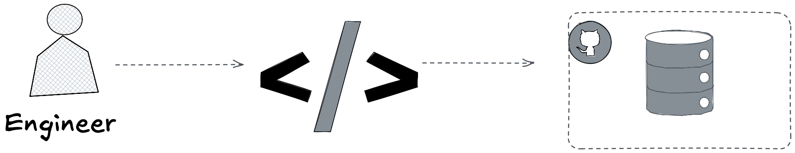
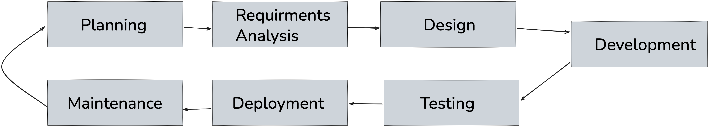
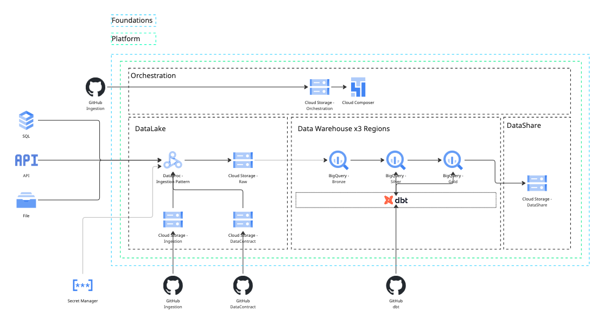

# We Are Giving Smart Models Dumb Work
*Scaling Credeq's developer operations with AI agents, and why finding the right bottleneck, not just the right agent, is what gets things done quicker.*

# Framing

Knowing which tool to use is table stakes. Any engineer can learn that in a year. The good ones build tools instead. The great ones build tools that build leverage, systems that let one person's judgment do the work of ten pairs of hands. None of this is new. Documentation, linters, CI pipelines, and now agents are the same instinct wearing a new outfit. We keep discovering the wheel and calling it innovation.

Credeq runs on 7 repositories: Infrastructure, Data Contracts, Data Ingestion, Orchestration, and a dbt repo per region. Each one is its own little kingdom, run by engineers who know its scar tissue better than anyone else on earth ever will. Now put AI agents to work inside those repos. What they show up with is broad, general capability, and none of the local kind, the particular scar tissue of this repo, this region, the one config nobody ever wrote down. That gap is real. It's just not the interesting part.

The interesting part is that the constraint from the first paragraph never went away, it just moved. Knowing which tool to use was always the engineer's job, not the tool's. Add an agent to the mix and someone still has to decide whether this is a job for it at all, and if so, which one, with which context, on which repo. Skip that judgment call and you haven't removed the skill requirement, you've just hidden it behind a prompt. The interesting question was never whether agents need context. Obviously they do. It's *where that context should live*, *who actually has to carry it around*, and who's still on the hook for knowing when not to reach for an agent at all.

There's a second constraint, and this one costs real money: time. Pick two, they say. Speed, quality, cost. As a codebase grows, that old rule doesn't go away, it just gets harder to dodge. Engineers get forced into a trade. Ship features fast, or keep the system healthy. Rarely both, and never forever.

So here's the actual challenge, and it isn't "add more agents." It's how you get faster without quietly paying for it in quality, or in cash, later.

More agents, aimed right, is one way through that trade. Not one agent per repo carrying every rule Credeq has ever written. Agents built for the repo they live in, carrying only what that repo needs, and nothing else. That's the shape of the fix. What's still missing is where, exactly, engineers are actually losing the time in the first place. That's next.

## Framing the Lifecycle

To truly understand how we can scale engineering operations, we first need to agree on what an engineer actually does, and what an engineering operation is.

Strip away the job titles, the standups, the Githib issues, and it comes down to this: an engineer writes code, and gets that code into a repository. Everything else, the skills they've picked up, the tools they reach for, exists to serve that one act. A linter, a framework, a snippet library, an agent, all of it is just scaffolding around the same two steps. Write the code. Push the code.

That's an oversimplification, obviously. No engineer's job is two steps. But first principles don't need to be polite, they just need to be true, and this one is. Write code, push code, everything else is decoration.

In practice, that decoration is most of the job. The loop grows steps around the core: plan the change, write it, test it, review it, merge it, ship it, watch it in production, then start over the moment something breaks or something new needs building. That longer loop has a name. It's called the software development lifecycle, and it's where the real bottlenecks live.

Worth being precise about that word, since the rest of this document leans on it. A [bottleneck](https://www.atlassian.com/work-management/project-management/bottlenecks) isn't just "the slow part." It's the one step in a process that limits how fast everything downstream of it can move, no matter how fast the other steps get. Speed up every other stage in the lifecycle and the bottleneck doesn't care, work still piles up in front of it at the same rate. Which means the fix is never "make the whole loop faster." It's find the one step actually capping throughput, and leave the rest alone. Here's what that loop actually looks like.

### The Software Development Lifecycle

If we want to scale the practice and not just headcount, agent headcount included, this is where we start. Find the step that's actually eating engineers' time and not just the step that feels slow, the one that is slow. Then, and only then, ask if AI even belongs there. Skip that and just point agents at the whole lifecycle at once, and congradulations you have succesfully automated the wrong problem very efficiently.

Seven boxes, seven arrows, and one that loops back to the start. Planning, requirements analysis, design, development, testing, deployment, maintenance, and then round again, because software is never actually finished, it's just released. Every one of those boxes eats time. Not the same amount, and not for the same reasons, which is exactly the point.

***Planning.*** Figure out what you're building and why. Scope, timeline, resources, and a hard look at whether the thing is even worth doing.

***Requirements Analysis.*** Turn the vague business ask into concrete specs. What the system must do, and what it isn't allowed to break while doing it. Usually ends in sign-off from whoever asked for it.

***Design.*** Turn the requirements into a blueprint. Architecture, data models, tech stack, how the pieces talk to each other, before anyone writes a line of code.

***Development.*** The actual coding. Write the code, against the spec this time, not just from first principles.

***Testing.*** Break it on purpose before someone else breaks it by accident. Catch the bugs and the places where the build doesn't match what step two promised.

***Deployment.*** Ship it. Push the tested code into production, staged rollout or full release, doesn't matter which.

***Maintenance.*** The part nobody puts on the roadmap. Bug fixes, patches, tuning, watching it not fall over, until the next planning cycle starts the loop again.

That loop-back arrow, from maintenance to planning, is the whole reason it's called a lifecycle and not a project plan. Software doesn't end at deployment.

None of these seven boxes are honest about the work that doesn't fit in a box. Writing the tests, not just running them. Writing the documentation nobody reads until the person who wrote the code has left. Updating a runbook, answering the same question in Slack for the third time this month. That work doesn't live in Testing or Maintenance, it lives inside every box, quietly, and it's exactly the kind of work a diagram is bad at showing and a timesheet is bad at capturing. Which is a problem, because if you can't see it, you can't tell whether it's the bottleneck.

And this is the version everyone draws on a whiteboard. Seven clean boxes, one repo, one team who owns the whole loop start to finish. Credeq doesn't work that way, and neither does anyone else past a certain size. The moment you're running this loop across multiple repos, multiple teams, and now agents that only know what they've been told, the diagram stops being the hard part. Knowing which box is actually slow, for which repo, and why, is.

### Scaling the SDL to a Global Data Platform

Credeq's global data platform is, at minimum, 7 repositories. Not one lifecycle. Seven of them, each running at its own pace, bottlenecked in its own place, for its own reasons.

- **dbt Region** — dbt modules and transformation logic for a specified region
- **Data Platform Foundations** — the infrastructure as code underneath all of it
- **Data Platform** — the modules that build up the data warehouse itself
- **Data Orchestration** — the Airflow DAGs that keep everything running on schedule
- **Data Contracts** — the contracts that govern what's allowed in from ingestion sources

Treat that as one lifecycle and you're measuring the wrong thing. A slow step in dbt Africa is not the same bottleneck as a slow step in Data Contracts, even when they show up on the same dashboard looking identical. So before anyone reaches for an agent, the actual work is boring and unavoidable: define the lifecycle for each of these seven on its own terms, and find out where each one is actually losing time.

## Problem Statement

Now that we have the proper context for the greater problem at hand, we can put the problem statement into words.

**Scale Credeq's developer operations with AI agents, without compromising on quality, while increasing engineering velocity.**

Three things in one sentence, and each one can quietly kill the other two. Scale carelessly and quality erodes. Chase velocity and the repos closest to launch cut corners the others won't. Protect quality by slowing everything down and you haven't solved the problem, you've just renamed it. The point of everything above, the lifecycle, the seven repos, the bottleneck specific to each one, was to earn the right to say this sentence without it being a slogan. An AI agent is just another tool. Not a strategy, not a solution by default, a tool, same category as a linter or a CI pipeline, and it's only as good as the bottleneck it gets pointed at. Aim it at a real slow step, in a specific repo, without breaking what that repo already does well, and it earns its keep. Aim it at nothing in particular and it's just an expensive way to feel busy.

## Global Platform components. 

We have established that each Repo has it's own lifecyle and each 

