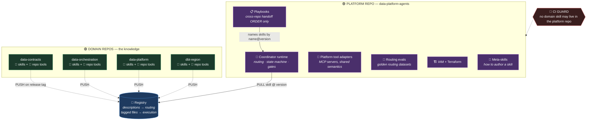
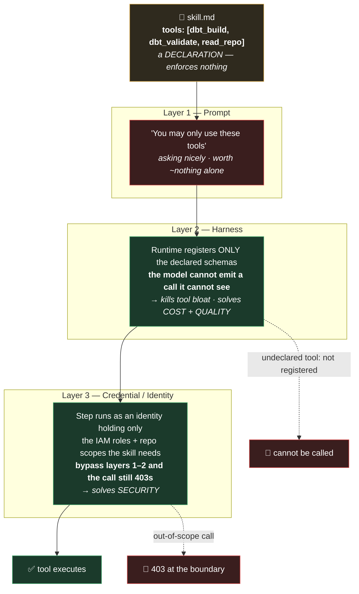
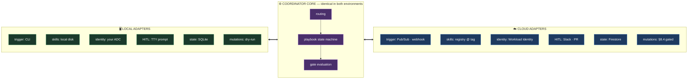
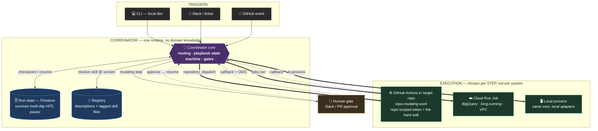
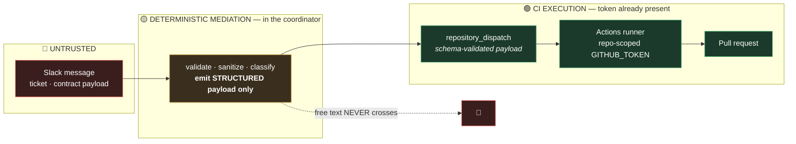

# Addendum — The Coordinator, Tools, and Where the Code Actually Runs

*Companion to "It's not about what you know but who you know." This addendum closes the questions the main document raises but does not answer: where the central coordinator lives, how tools are declared and enforced, how an engineer runs cross-repo workflows on a laptop, and what the thing looks like once it's on GCP.*

> **How to read this.** §A1 places the coordinator's code and introduces the artifact the main doc is missing (the playbook). §A2 rebuilds the tool story into declaration / implementation / enforcement. §A3 makes local development a first-class target. §A4 picks the cloud execution topology. §A5 names the new trust boundary that §A4 creates. §A6 proposes the ADRs. §A7 lists the edits the main document needs.

---

## A1. Where the Coordinator Lives

### A1.1 One platform repo

The coordinator is code, and code needs an owner. It lives in a single platform repository — call it `data-platform-agents` — which holds:

- the **coordinator runtime** — routing, playbook execution, gate evaluation, the run state machine
- **cross-repo playbooks** — declarative workflow definitions (§A1.2)
- **platform tool adapters** — the MCP servers every repo shares (§A2.2)
- **deployment and IAM configuration** — Terraform, service accounts, workload identity
- **routing evals and golden routing datasets** — the coordinator's own test suite
- **meta-skills** — "how to author a skill," "how to run a routing eval"

### A1.2 Does it hold skill files? No domain skills — but yes, playbooks

This is the gap in the main document. §7.3 says the central coordinator "invokes each repo's skills in handoff order." It never says where handoff order lives. There are only three candidates and two of them are wrong:

| Candidate | Verdict |
|---|---|
| In a repo | ✗ No single repo owns a cross-repo workflow. Whichever repo you pick becomes wrong the first time the sequence changes. |
| Inferred by the model per run | ✗ Non-deterministic routing on the highest-stakes path. This is exactly the misroute risk §14 already flags, made structural. |
| A versioned artifact in the platform repo | ✓ Reviewable, diffable, testable, rollback-able. |

So handoff order is an artifact, and it lives centrally:

```yaml
# playbooks/new-ingestion-field.yaml
name: new-ingestion-field
description: A new field arrives from an ingestion source
version: 1.2.0
participating_repos: [data-contracts, data-orchestration, data-platform, dbt-region]
steps:
  - skill: validate-contract-change@^2.1      # data-contracts
  - skill: update-ingestion-dag@^1.4          # data-orchestration
  - skill: add-warehouse-column@^3.0          # data-platform
  - skill: propagate-to-silver@^1.9           # dbt-region
gates: [peer_review, legacy_comparison]
on_step_failure: halt_and_notify
```

Read it closely: it references skills by `name@version` and contains **zero domain knowledge**. It does not know what a conformed dimension is, what the dedup convention is, or which config nobody wrote down. It knows only *who, in what order*.

**The line to draw explicitly:** *sequence is routing metadata; scar tissue is domain knowledge.* Sequence is allowed in the platform repo. Scar tissue never is. Without that sentence written down, a reasonable engineer reads §7.3 and concludes handoff logic belongs in the coordinator's prompt — which breaks **ADR-003** and rebuilds the omniscient coordinator the whole document argues against.

### A1.3 Enforce the boundary in CI, not in prose

ADR-003 is currently a promise. Make it a test. Add a check to the platform repo's CI:

> Reject any file carrying skill frontmatter whose `repo:` field is not the platform repo itself.

Cheap to write, impossible to argue with, and it means the invariant survives the third new hire who "just needed to put one dbt rule in the coordinator to unblock a release."

### A1.4 Governance: playbooks need multi-team approval

A skill is governed by one repo's CODEOWNERS (§8.11). A playbook spans four. So playbook CI requires **CODEOWNERS approval from every repo named in `participating_repos`.** A cross-repo workflow should not be silently re-sequenced by one team.

### A1.5 The knowledge boundary, drawn



### A1.6 A correction to "one agent per repo"

§6 Step 2 reads as though you deploy N services. **You should not.** A repo agent is **the same runtime invoked with a different configuration**:

- this repo's skill set
- this repo's tool allowlist
- this repo's identity

**N repo agents = N configs, 1 runtime.** Three things follow:

1. Most of §11's "more moving parts than one agent" drawback evaporates — there is one deployable, not five.
2. A new repo becomes a config file, not an onboarding project. §9's "new repo → add one agent" becomes literally true.
3. Local/cloud parity (§A3) is possible at all — you cannot achieve parity across five bespoke services.

---

## A2. How Tools Come Into Play

The main document's `tools: [dbt_build, dbt_validate, read_repo]` is a **declaration**. It says nothing about who implements the tool, where the credential comes from, or what stops the model calling something else. Those are four different concerns.

### A2.1 A tool is four things

| Part | Lives where | Why there |
|---|---|---|
| **Name + JSON schema** | skill frontmatter + registry | routing needs it; validation needs it |
| **Implementation** | platform repo *or* target repo (§A2.2) | depends on whether semantics are shared |
| **Credential** | Secret Manager / IAM / GitHub App | never in a skill, never in a prompt |
| **Permission to call it** | the harness + the runtime identity (§A2.3) | this is the only part that actually enforces |

### A2.2 Two classes of tool, two homes

**Platform tools** — `read_file`, `write_file`, `open_pr`, `bq_query`, `trigger_dag`, `run_shell`. Implemented once in the platform repo, versioned centrally, exposed as MCP servers. Every repo gets identical semantics, so a skill written for one repo behaves the same in another.

**Repo tools** — `dbt_build` for *this* dbt project, `contract_validate` for *these* contracts. Thin wrappers over what the repo already has: a Makefile target, a CLI entrypoint, a script. **They belong in the repo**, beside the skill that declares them, because they change when the repo changes. Colocation is the same argument the main document makes for skills — apply it consistently.

The division of labour: **the skill declares the name, the repo provides the entrypoint, the platform provides the invocation contract.**

```yaml
# .agents/tools.yaml — in the target repo, reviewed by the same CODEOWNERS
tools:
  dbt_build:
    entrypoint: "make dbt-build"
    schema: { model: string, target: string }
    mutating: true
  dbt_validate:
    entrypoint: "make dbt-validate"
    schema: { model: string }
    mutating: false
```

### A2.3 Enforcement has three layers — and the doc conflates two of them



**Layer 2 solves cost and quality. Layer 3 solves security. They are different problems.**

This matters for the risk register. §14 lists *"harness can't scope tools → isolation degrades to convention"* as a **blocking** risk. Only layer 2 depends on the harness — and layer 2 is a loop over a config file, not a platform capability you wait on a vendor for. Layer 3 depends on your identity plumbing, which you own entirely. So the honest framing is:

> If the harness cannot scope tools per skill, you lose the tool-bloat mitigation (cost and accuracy degrade). You do **not** lose the security boundary, because that is enforced by identity, not by the harness.

That is a materially smaller risk than the one currently written down, and it de-escalates your loudest blocker.

### A2.4 MCP is the mechanism

One MCP server per tool domain — `github`, `bigquery`, `dbt`, `composer`. The harness connects **only** the servers a skill's allowlist names, and each server runs under its own service account. The same wiring works on a laptop and in Cloud Run, which is what makes §A3 possible.

---

## A3. Running the Coordinator Locally

**Design principle: local and cloud are the same core with different adapters.** If local is a separate implementation, you get drift, "works on my machine," and engineers who quietly stop trusting the cloud path. Build the coordinator as a **library + CLI**; make everything environmental an adapter.

### A3.1 The adapter table

| Adapter | Local | Cloud |
|---|---|---|
| **Trigger** | CLI invocation | Pub/Sub, webhook, GitHub event |
| **Skill source** | **local working copies** (`--skill-source=local`) | registry, tagged version |
| **Registry (routing)** | read-only against the real registry | Firestore |
| **Repo access** | your existing local checkouts | GitHub App installation token |
| **Identity** | your `gcloud` ADC | Workload Identity / per-step SA |
| **HITL gate** | TTY prompt | Slack / PR review |
| **Run state** | local SQLite or JSON file | Firestore |
| **Tracing** | stdout | Cloud Trace |
| **Mutating actions** | **`--dry-run` by default**, branch-only | gated per §8.4 |

### A3.2 Local skill source is the killer feature

The thing an engineer actually wants is this: *I am editing `build-conformed-dimension.md` right now; let me run the cross-repo workflow against my uncommitted version before I tag it.*

So: **pull routing metadata from the real registry, resolve skill bodies from disk.** Without this, the authoring loop is tag → push → pull → run → discover typo → tag again, and nobody will maintain skills. §14 lists "skill drift" as a risk and offers colocation as the mitigation — but colocation only helps if editing a skill is pleasant. This is what makes it pleasant.

### A3.3 Local identity is least privilege for free

The local coordinator runs **as you**. It can never exceed what you can already do by hand. No sandbox engineering is required to make local development safe — your existing IAM already bounds it. This is why local is the right place to start (§A4.5).

### A3.4 The workspace model

Cross-repo work locally needs to resolve `repo: data-contracts` to a directory instead of cloning:

```yaml
# ~/src/credeq-workspace.yaml
repos:
  data-contracts:      ~/src/data-contracts
  data-orchestration:  ~/src/data-orchestration
  data-platform:       ~/src/data-platform
  dbt-region:          ~/src/dbt-region-africa
defaults:
  dry_run: true
  hitl: tty
```

```bash
# Cross-repo workflow, on a laptop, against uncommitted skills
dpa run new-ingestion-field \
  --input "new field: merchant_category_code from Adyen" \
  --workspace ~/src/credeq-workspace.yaml \
  --skill-source local \
  --dry-run

# Single local workflow — no central hop, matching the doc's cheap common case
dpa run-skill build-conformed-dimension \
  --repo dbt-region \
  --input "dim_merchant"
```

The same command runs in CI with different flags. **That symmetry is the whole point** — and it's the reason the P0 in §A4.5 can be so small.

### A3.5 Core-plus-adapters, drawn



---

## A4. Cloud Topology — Cloud Run Jobs *and* GitHub Actions

You framed this as either/or. It isn't. **Split it, and split it on one axis: does the step mutate a repo?**

### A4.1 Coordinator: a Cloud Run *service*, not a Job

It is event-driven, it accepts webhooks, and — critically — **it must survive HITL pauses that can last days.**

This is a real gap in the main document. §8.8 requires "durable execution"; the GCP table in *The Architecture on GCP* maps the host to plain Cloud Run, which scales to zero and loses in-memory state. **A paused approval is not a long-running request — it is a suspended state machine.** So: run state in Firestore, resume-by-event, and Cloud Workflows (or Temporal) underneath if the playbooks grow branches. Durable execution is a requirement, not a nice-to-have.

### A4.2 Repo-mutating steps: GitHub Actions in the target repo

Trigger via `repository_dispatch`. The argument is hard to beat:

> **ADR-001 says the repo is the agent boundary. A per-repo Actions workflow with a repo-scoped `GITHUB_TOKEN` *is already that boundary*, enforced by GitHub.**

You get the hard wall the document wants without building it. Plus:

- code is already checked out — no clone plumbing, no clone cost on every step
- branch protection, CODEOWNERS, and required checks apply natively
- "hand back at the PR" (§8.1 `postconditions`) is the native output, not something you implement
- secrets and OIDC → Workload Identity Federation are already configured per repo
- engineers already know how to read Actions logs when the agent does something dumb

### A4.3 Non-repo steps: Cloud Run Jobs

Legacy comparisons in BigQuery, long analyses, anything needing VPC access or exceeding Actions' limits. No checkout matters, so Actions buys nothing.

### A4.4 Advance the playbook on callback, not by polling

Each Actions run POSTs back to the coordinator on completion with an OIDC token; the coordinator validates the token and advances the playbook. Polling check-runs works, but it burns latency and API quota on every step of every run.



### A4.5 Start smaller than all of this

§6 says "deliver value first, lock in least." Honour it. **For P0, skip Cloud Run entirely:** put an orchestrator workflow in the platform repo that `repository_dispatch`es to the other repos and polls for completion. No Firestore, no Pub/Sub, no service to secure, no VPC.

Ship that, learn where routing actually misfires, then lift the coordinator into Cloud Run when you need Slack triggers, sub-minute latency, and durable pauses. **The migration is a trigger adapter and a state adapter** — both of which you already built in §A3.

### A4.6 Decision rule, stated once

| Step characteristic | Runs on |
|---|---|
| Mutates a repo (edits files, opens a PR) | **GitHub Actions** in that repo |
| Touches BigQuery, needs VPC, or runs long | **Cloud Run Job** |
| Routing, gate evaluation, state transitions | **Coordinator** (Cloud Run service) |
| Anything, during authoring or debugging | **Local process**, same core |

---

## A5. The New Trust Boundary §A4 Creates

Running repo-mutating work in Actions introduces a path the main document does not currently cover: **an untrusted Slack bug report can now reach a runner holding a token that can push branches.**

§8.2 sanitizes untrusted input before "any tool call." Under this topology, **the `repository_dispatch` *is* the tool call — and it is the one that crosses a trust boundary into CI.** Two rules follow:

1. **Mediation happens in the coordinator, before dispatch.** Never inside the runner, where the token already exists.
2. **The dispatch payload is a validated structured schema — never free text passed through to the runner's prompt.** `{"field": "merchant_category_code", "source": "adyen", "type": "string"}`, not the Slack message body.



---

## A6. Proposed ADRs

Following the main document's format — immutable once accepted; supersede rather than edit.

**ADR-008 — Cross-repo handoff order lives in versioned playbooks in the platform repo.**
*Status:* Proposed. *Context:* no single repo owns a cross-repo workflow, and model-inferred sequencing makes the highest-stakes path non-deterministic. *Decision:* handoff order is a declarative, versioned artifact in the platform repo, referencing skills by `name@version`; sequence is routing metadata, scar tissue is domain knowledge, and only the former may live centrally. *Consequences:* + sequence is diffable, testable, rollback-able; + ADR-003 survives contact with cross-repo work; − playbooks need multi-team CODEOWNERS approval; − one more artifact class to version.

**ADR-009 — Repo agents are configurations of one runtime, not deployed services.**
*Status:* Proposed. *Context:* "one agent per repo" read as N deployables inflates the operational surface and makes local/cloud parity impossible. *Decision:* one runtime; a repo agent is a config declaring skill set, tool allowlist, and identity. *Consequences:* + a new repo is a config file, not a project; + removes most of §11's moving-parts drawback; − the shared runtime becomes a shared failure domain, so its release process needs the same eval gate as skills.

**ADR-010 — Execution target is chosen per step, not per system.**
*Status:* Proposed. *Context:* repo-mutating work in Actions inherits the repo boundary, checkout, branch protection, and CODEOWNERS for free; data work in Actions inherits nothing useful. *Decision:* repo-mutating steps run as GitHub Actions in the target repo; data and long-running steps run as Cloud Run Jobs; the coordinator runs as a Cloud Run service. *Consequences:* + ADR-001's boundary is enforced by GitHub rather than built; + no runtime cloning; − two execution paths to observe and trace; − introduces the dispatch trust boundary of §A5.

**ADR-011 — Durable execution is a requirement, not an enhancement.**
*Status:* Proposed. *Context:* §8.4 HITL gates can suspend a run for days; a scale-to-zero service loses in-memory state. *Decision:* run state persists in Firestore and runs resume by event; the coordinator holds no run state in memory across a gate. *Consequences:* + approvals can take as long as they take; − every playbook step must be a serializable state transition; − adds a datastore to the P1 critical path.

---

## A7. Edits the Main Document Needs

| # | Section | Change |
|---|---|---|
| 1 | §7.3 / new §7.5 | Introduce **playbooks**. State that sequence is routing metadata, not domain knowledge. Add ADR-008. |
| 2 | §6 Step 2 | Rewrite "one agent per repo" as *one runtime, N configs*. Add ADR-009. Update §11's moving-parts drawback. |
| 3 | §8.1 | Split the tool story into **declaration / implementation / enforcement**. Add the repo-tool `tools.yaml` contract. |
| 4 | §14 | Rewrite the "harness can't scope tools" row: it threatens **cost and quality**, not security. Security is identity-enforced. |
| 5 | *The Architecture on GCP* | Coordinator is a Cloud Run **service** with Firestore-backed run state. Add ADR-011. |
| 6 | New section | **Local Development.** Nothing in the document addresses how an engineer iterates on a skill, and adoption lives or dies there. |
| 7 | §8.2 | Add the dispatch boundary: mediation happens before `repository_dispatch`; payloads are structured, never free text. |
| 8 | §15 Glossary | Add **playbook**, **platform tool**, **repo tool**, **harness scoping**, **workspace**. |

---

## A8. Risks This Addendum Adds

| Risk | Impact | Mitigation |
|---|---|---|
| **Playbook drift from repo reality** | A skill is renamed or removed; the playbook silently breaks mid-run | Playbook CI resolves every `skill@version` against the registry; unresolvable reference fails the build |
| **Dispatch payload injection** (§A5) | Untrusted text reaches a runner holding a push-capable token | Structured-schema-only payloads; mediation in the coordinator, never in the runner |
| **Shared runtime is a shared failure domain** (ADR-009) | One bad runtime release breaks every repo agent at once | Runtime releases pass the same eval regression gate as skills (§8.5); staged rollout by repo |
| **Two execution paths** (ADR-010) | Traces fragment across Actions and Cloud Run; debugging gets harder | One trace ID propagated through `repository_dispatch` and callback; single trace view in Cloud Trace |
| **Local/cloud divergence** | The adapter seam rots; "works locally" stops meaning anything | One golden playbook runs in CI through **both** adapter sets on every runtime PR |
