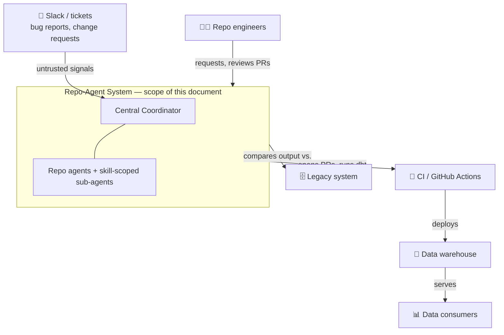
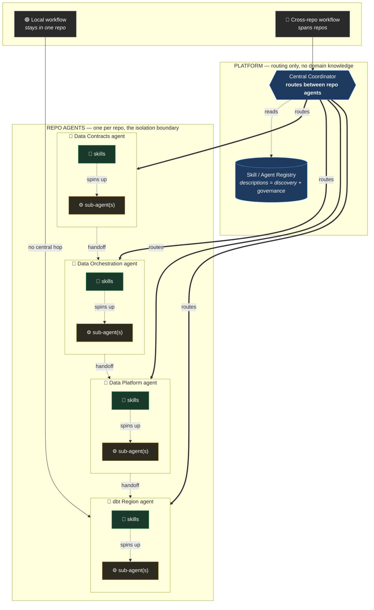
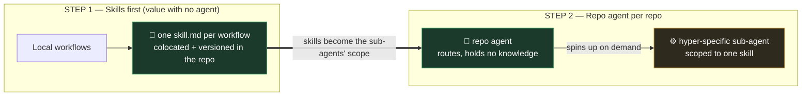
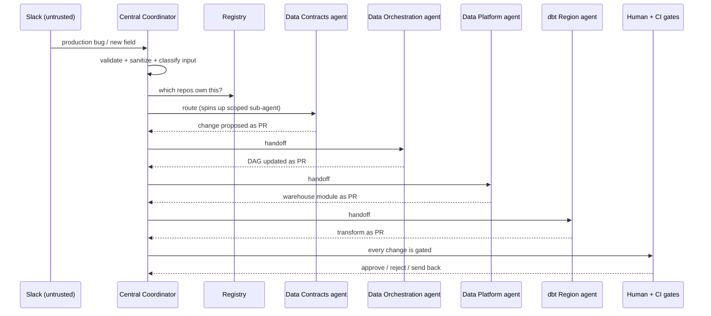
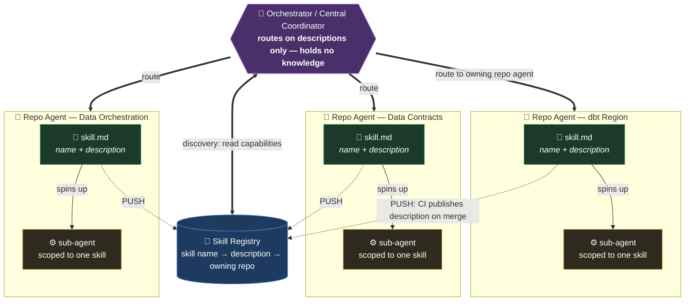
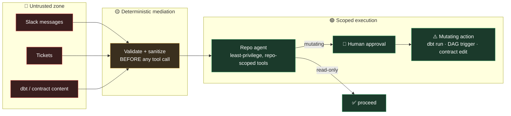
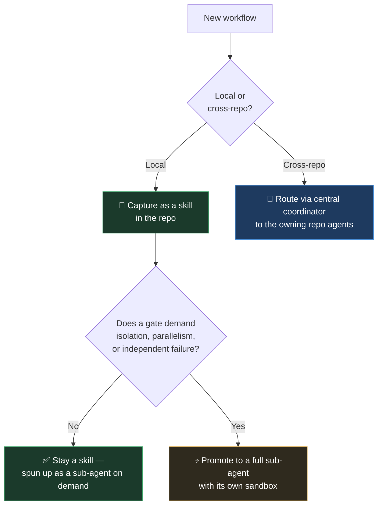

# Hyper-Specialized Colocated Repo Agents — Architecture

*Reference architecture for the agents on Credeq's global data platform: what it is, how it rolls out, and how it stays bounded, cheap, and correct in production.*

> **How to read this.** §1–4 set the frame (context, stakeholders, constraints, quality). §5–7 are the architecture (principle, rollout, structure, runtime). §8 is the load-bearing half for an agentic system — the skill contract, security, guardrails, evaluation, cost, and the rest. §9–15 record trade-offs, decisions, risks, and terms.

---

## 1. Context & Scope

The system runs on Credeq's global data platform: several repositories (dbt Region, Data Platform Foundations, Data Platform, Data Orchestration, Data Contracts), each with its own lifecycle, feeding a shared warehouse.



**In scope:** how agents are structured, placed, scoped, secured, evaluated, and operated across these repos. **Out of scope:** the platform's own design, the warehouse schema, CI itself, and any workflow the gates reject — an agent that fails the cost or quality gate isn't built.

## 2. Stakeholders & Concerns

| Stakeholder | Primary concern |
|---|---|
| **Repo engineers** | Own the repo's scar tissue; author and maintain its skills; velocity on local workflows without losing control of quality. |
| **Platform / data-platform team** | Own the central coordinator and cross-repo handoffs; keep the whole thing coherent. |
| **Engineering leadership** | Velocity and cost outcomes; proof the investment pays off (the speed scoreboard). |
| **Data consumers (downstream analytics)** | Correctness of the data; no agent-authored regressions reaching production. |
| **Security / compliance** | Untrusted input handling, least privilege, auditability of what agents did and why. |

**Coverage rule:** every concern above must be framed by at least one section below. Correctness → §8.5 Evaluation + §4 quality scenarios; cost → §8.7; security → §8.2; auditability → §8.11.

## 3. Constraints

Fixed facts the architecture cannot change and must design within:

- **Multi-repo platform.** Ownership is already decentralized; the design must respect repo boundaries, not fight them.
- **Existing CI gates.** `dbt validate` / `dbt build`, peer review, and legacy-system comparison already exist and remain the source of truth for correctness.
- **Sequential pipeline nature.** Cross-repo data flows are ordered (Contracts → Orchestration → Platform → dbt); the architecture must honor that order.
- **Cost is real money.** Every model call costs; the design is judged partly on cost per invocation.
- **Harness dependency.** Scoped sub-agents and per-skill tool allowlists require runtime support. Where the harness can't enforce scoping, some guarantees degrade to convention (noted in §8.2 and §11).
- **Human ownership.** The scar tissue lives with the engineers; the architecture captures it, it does not replace the owners.

## 4. Quality Attributes (Testable Scenarios)

The three constraints restated as measurable scenarios. Quality and cost are **gates** — checked before an agent ships; a violation vetoes. Speed is the **scoreboard** — read after, to judge whether it was worth it.

| Attribute | Scenario (stimulus → response) | Measure |
|---|---|---|
| **Correctness (gate)** | An agent builds a dbt dimension → it passes `dbt validate`/`build`, peer review, and legacy comparison before merge | Zero agent-authored regressions reach production |
| **Cost (gate)** | A local build request runs → only the relevant skill's context loads | Tokens/invocation stay flat as the repo adds skills (no bloat growth) |
| **Isolation (gate)** | A malicious/injected input reaches a sub-agent → it cannot act outside its repo | Tool permissions are repo-scoped; injection hits a permission wall |
| **Speed (scoreboard)** | The scaffolding bottleneck (Bronze/Silver/dedup/SCD/mapping) is targeted → hands-on engineer time drops | Time-to-PR for a new dimension, before vs. after |
| **Observability (enabler)** | Any run executes → it is traceable end-to-end | Every step is a span with token cost attributed |

## 5. Core Principle

**Distribute the knowledge, centralize only the routing.**

One rule decides everything: *the repo is the agent boundary.* Not one platform-wide agent that knows every repo (it averages every bottleneck into one and pays a tool-bloat tax on every call), and not a loose pile of skills with no runtime. One agent per repo, carrying only that repo's scar tissue, behind a central coordinator that routes but knows nothing.

| Level | Unit | Role | Holds domain knowledge? |
|---|---|---|---|
| Platform | **Central coordinator** | Routes cross-repo work to the repo that owns it | No — routing only |
| Repo | **Repo agent** | Isolation + runtime boundary; one per repo | Yes — only its own repo's |
| Inside the repo | **Skills → hyper-specific sub-agents** | Keep the repo agent lean; invoked/spun up selectively | Yes — one narrow slice each |

The invariant that must survive to the end: **at any moment, only the knowledge a given request actually needs is in context.** The day "fully automated" means "everything loaded at once," the cost and quality gates both fail.

## 6. The Two-Step Rollout

The architecture is built in the order that delivers value first and locks in the least.

### Step 1 — Capture every local workflow as a `skill.md`

Before any agent exists, go repo by repo and write down the local workflows — those that start and finish inside a single repo — each as its own skill file:

- One skill per workflow, not one skill per repo. A skill covers *one* thing (e.g. "build a Silver-layer model," "build a conformed dimension") and nothing else.
- The skill file lives **in the repo it serves**, versioned with the code, reviewed in the same PR, owned by the same CODEOWNERS.
- Each skill carries only its own slice of scar tissue: the configs, conventions, and the one rule nobody wrote down because everyone just knew.

Step 1 pays off **on its own, with no agent attached** — documentation, onboarding, and a machine-readable map of where the work is. You never hold a half-built system that does nothing until it's finished.

### Step 2 — Give each repo an agent that spins up hyper-specific sub-agents

Once a repo's workflows are skills, add **one agent for that repo.** It's not a bucket that swallows every skill at once — it's a coordinator that, per request, **spins up a sub-agent scoped to exactly the skill(s) needed** and nothing else.

- The repo agent holds **no domain knowledge of its own.** It knows which skill owns what, and in what order to run them.
- Each sub-agent runs on a **lean prompt** — one skill's rules, one narrow tool set — so no sub-agent pays for another's context.
- The repo agent is the **isolation boundary**: its sub-agents run with tool permissions scoped to that repo.

Cross-repo workflows are the only case a single repo agent can't see. Those go up to the **central coordinator**, which routes to each repo agent in handoff order.

## 7. Building Block & Runtime Views

### 7.1 Architecture at a glance (static structure)



### 7.2 The two-step rollout, visualized



### 7.3 Runtime view — a cross-repo workflow (Slack production bug)



### 7.4 Capability Discovery — how the orchestrator knows what each repo can do

The orchestrator holds no domain knowledge, so it learns what each repo *can do* without absorbing how it works — through the **registry**. Each skill advertises a one-line capability (`name` + `description`); those are collected centrally; the orchestrator routes on the descriptions alone. Knowledge stays distributed, only discovery is centralized.

The flow runs top-down — orchestrator, to registry, to repo agents, to skills, to the sub-agents that do the work:



**Only descriptions travel up.** The registry holds the *name → description → owning repo* triple and nothing else — never the skill body. The orchestrator matches a request against those one-liners, picks the owning repo agent, and hands off; the repo agent loads the full skill and spins up the sub-agent locally, at execution time.

#### Push vs. Pull — keeping the registry current

The registry is only useful if it reflects what the repos can do *right now*. Two ways to keep it in sync, and it's a genuine trade-off:

| | **Push** (recommended default) | **Pull** |
|---|---|---|
| **Who updates it** | The repo's CI publishes its skill descriptions to the registry on merge | The orchestrator scans each repo's skill files on demand |
| **Freshness** | Always current — updates in the same PR that changes the skill | Current only as of the last scan |
| **Drift risk** | Near zero — capability and advertisement move together | Possible between scans; a stale cache misroutes |
| **Cost / latency** | Paid once at merge, off the hot path | Paid at request time, on the hot path |
| **Coupling** | Repo must know how to publish | Orchestrator must know how to reach every repo |

**Push-on-merge is the default:** the registry updates in the same PR that changes the skill, so the advertisement can't drift and discovery stays off the hot path. **Pull** is the fallback where a repo can't publish (no CI hook, external repo). The robust option is **hybrid** — push as primary, with a periodic pull to reconcile anything that failed to publish.

---

## 8. Cross-Cutting Concerns

Everything below exists only because the system is a **non-deterministic actor that reads untrusted input, wields tools against production data, costs money per step, and can loop, hallucinate, or be hijacked.** A generic microservice wouldn't need these sections; this one can't ship without them.

### 8.1 The Skill Contract & Scoping Model

The skill is the system's distinctive primitive. Every `skill.md` declares a contract in frontmatter, and a sub-agent is scoped to exactly one skill — nothing more enters its context. That *is* the tool-bloat mitigation: each sub-agent sees only its own skill's tools.

```markdown
---
name: build-conformed-dimension
description: Build one conformed dimension end-to-end from Silver models  # used for routing + registry
owner: "@dbt-region-team"          # CODEOWNERS
version: 1.4.0                       # SemVer (see §8.10)
repo: dbt-region
tools: [dbt_build, dbt_validate, read_repo]   # allowlist — the sub-agent gets ONLY these
permissions: read-write              # read-only | read-write (write triggers §8.4 gates)
preconditions: "source-to-target mapping and grain are settled"
postconditions: "hands back at the PR once dbt validate/build is green"
stopping_condition: "max 8 tool iterations OR dbt build green"   # required (see §8.3)
answers_to_gates: [dbt_validate, peer_review, legacy_comparison]  # external checks it does not own
promote_to_subagent_when: "needs its own sandbox, parallelism, or independent failure"
---
```

**Rule:** a skill with no declared `tools`, `permissions`, and `stopping_condition` does not ship. The contract is what makes scoping enforceable rather than aspirational.

### 8.2 Security & Trust Boundaries

The highest-consequence section, because agents act on production data.



- **Untrusted input.** Slack messages, tickets, dbt model contents, and contract payloads are untrusted. They are validated and sanitized by deterministic code *before* any tool fires — never fed straight into a tool call.
- **Least privilege / confused-deputy.** Each repo agent and sub-agent holds only the permissions its scope needs, scoped down on completion. A successful prompt injection then still hits a permission wall — it cannot reach another repo.
- **Read vs. mutating.** Every skill declares which. Read-only work proceeds; mutating work (`dbt run`, DAG trigger, contract edit) routes through the §8.4 human gate.
- **Secrets.** Short-lived, user-scoped tokens; no long-lived credentials in a skill's context; sandboxed execution for anything that writes.

### 8.3 Guardrails & Stopping Conditions

- **Layered validation.** Pre-tool guardrails (schema-valid, PII-screened, injection-screened inputs) and post-tool guardrails (output quality, action validation before a mutating tool fires).
- **Critic / evaluator.** For high-accuracy outputs, pair the generator with a critic that approves, rejects, or sends back — the review-and-critique pattern, kept running in production, not just checked once at the door.
- **Runaway prevention.** Every skill declares a stopping condition (max iterations, token/step budget). Without one, a loop can run indefinitely and cost is the only symptom.
- **Retry-then-fallback.** Two retries with increasingly specific instructions; on the third failure, return a canned fallback and log the incident for a human.

### 8.4 Human-in-the-Loop Gates

Named, concrete actions that require a human to sign off *before* execution:

- Modifying a **data contract**.
- Deploying a **dbt model change to production**.
- Triggering a **production DAG**.
- Any **irreversible or destructive** operation.

The approval surface lives in Slack (or the PR), a paused run persists its state (§8.9) and resumes on approval. Everything the framework leaves to humans and CI — PR review, DAG triggers, the two legacy comparisons — stays there by design. The agent produces; it never marks its own homework.

### 8.5 Evaluation & Testing

The agent equivalent of a test suite, and *the* mechanism that makes editing a skill file safe.

- **Golden datasets per skill** — versioned, human-validated representative inputs with trusted expected outputs, grown from real failures. Never let an agent write its own ground truth.
- **LLM-as-judge** with explicit rubrics, pinned to a *different* model family than production (or subjective scores inflate).
- **Trajectory evaluation** — score the steps taken, not just the final answer (did it pick the right skill, in the right order, with the right tools).
- **Regression gate in CI** — a fast replay suite that blocks a skill-file merge if any metric drops below threshold. A skill change that fails its evals does not deploy.

### 8.6 Observability, Tracing & Cost Accounting

You cannot debug a multi-agent run you can't see. The coordinator → repo agent → sub-agent path is a **nested call tree**, so a flat log won't do.

- **Distributed tracing** (OpenTelemetry GenAI conventions): each tool call, model invocation, and retrieval is a child span; child sessions link back to the parent's tool-call span.
- **Cost/latency per span**, attributed to agent and workflow. Cost is the canonical anomaly signal: a run using 50k tokens for a 3k-token job is probably stuck in a loop (§8.3).
- **Reasoning trace** captured for every action — tool selection and execution path — so a bad output can be diagnosed, not just observed.

### 8.7 Model Selection, Routing & Budgets

Model tier is a first-class architectural decision, not an implementation detail.

- **Routing / cascade.** The coordinator runs on a cheap, fast routing model (a routing decision carries no domain context). Sub-agents are tiered by task complexity: simple scaffolding on a cheaper tier, hard judgment on a frontier tier, with escalation-on-failure.
- **Prompt caching.** Skill markdown is a stable, cacheable prefix — a large, cheap win on every invocation of that skill.
- **Budgets.** Per-run and per-tenant token budgets with hard caps, tied to the stopping conditions in §8.3.

### 8.8 Failure Modes, Fallbacks & Idempotency

- **Retries** with exponential backoff + jitter; unregulated retries risk duplicated work and cascading failure.
- **Idempotency keys** on every mutating action so a retried `dbt run` / DAG trigger / write does not double-execute — essential on a data platform.
- **Compensating transactions** to roll back to a known-good state; **circuit breakers** to isolate a malfunctioning repo agent.
- **Graceful degradation** — the coordinator falls back to a narrower skill or a human handoff when a repo agent is down, rather than failing the whole workflow.
- **Durable execution** so retries and paused human-gates survive process restarts.

### 8.9 State, Memory & Handoff

- **Short-term scratchpad** — checkpointed session state within a single run.
- **Shared context store** — durable business context agents query before acting (Firestore / Cloud SQL / equivalent, not in-memory).
- **Handoff record** — the coordinator passes *only what the next agent needs*, never the whole conversation; context bloat is a cost and a quality risk.
- **Source of truth** — the data contract and dbt manifest are authoritative, not an agent's memory. Agents read the source of truth; they don't become it.

### 8.10 Versioning & Change Management

Skills change often, so they are versioned, governed artifacts — not config.

- **SemVer per skill** (major/minor/patch across prompt, tool schema, execution logic).
- **Backward compatibility** for skills the coordinator routes to; breaking a skill's contract is a major bump with a migration path.
- **Independent rollback** — revert one skill version without touching the rest.
- Every change flows through the §8.5 eval/regression gate before deploy.

### 8.11 Governance, Registry & Audit

- **Registry** — the catalog of every agent and skill; its descriptions are what let the coordinator discover and route (see §7.4 for the discovery flow and the push/pull sync model). Discoverability falls out of writing skills.
- **Ownership** — who owns each repo agent and skill (CODEOWNERS), with quality gates on changes.
- **Audit trail** — which agent used which skill *version*, with what inputs, producing what side effects. Both an operational aid and a compliance requirement.

---

## 9. Benefits

- **Incremental payoff — value before any agent exists.** Step 1 alone gives documented, machine-readable workflows and a map of where the real work is.
- **Ownership and colocation are automatic.** A skill is a file in the repo — versioned with the code, reviewed in the same PR, owned by the same CODEOWNERS. Rule and code can't silently drift apart.
- **Isolation is a hard wall, not a polite request.** Because the *repo* is the agent boundary, every sub-agent runs with repo-scoped permissions. A specialist can't wander into another repo — the sandbox enforces it.
- **Cost stays lean on every invocation.** Progressive disclosure loads only the relevant skill. No sub-agent reasons through five repos' — or even two skills' — worth of rules to do one job. The common case stays cheap, and that compounds.
- **The quality gate stays external.** The agent produces; humans and CI veto. No agent marks its own homework.
- **The registry comes for free.** The set of skill descriptions *is* the catalogue.
- **It scales the way the org scales.** New repo → add one agent. New workflow → add one skill. Nothing existing gets rewritten; no shared prompt gets heavier.
- **Parallelism across repos.** Independent repo agents can run concurrently where the handoff allows, instead of one giant agent serializing everything.
- **No single point of *knowledge*.** The coordinator routes but knows nothing — no one prompt has to understand the whole platform.

## 10. Limitations

- **Cross-repo coordination must be designed, not assumed.** Sequential handoffs and evaluators are patterns you build; making a repo agent bigger doesn't produce coordination.
- **Isolation *between sub-agents in the same repo* is soft.** The hard wall is the repo boundary; inside a repo, scoping relies on selective invocation and harness-enforced allowlists.
- **The cost win is conditional on selective invocation.** Preload a repo's skills into one prompt and you've rebuilt the mega-agent inside a single repo.
- **It assumes harness support.** Scoped sub-agents and per-skill tool allowlists depend on the runtime; without it, per-skill isolation is convention, not guarantee.
- **The central coordinator is a routing single point.** It holds no knowledge, but a misroute sends cross-repo work to the wrong repo agent. Routing correctness is itself a gate.

## 11. Drawbacks

- **Upfront decomposition is real work.** Writing every local workflow as a well-scoped skill is a genuine investment before Step 2 returns anything.
- **Skills drift if unmaintained.** A skill not updated with its code becomes confidently wrong. Colocation makes drift *visible* in review; it doesn't prevent it.
- **More moving parts than one agent.** A coordinator, N repo agents, and many skills is more surface to build, monitor, and reason about.
- **Routing and multi-hop latency.** Cross-repo work pays for a routing call and several sequential hops — small per call, but it grows with the chain.
- **Governance spread across repos.** Auditing "what can act, and where" is a cross-repo exercise; the registry mitigates but doesn't erase it.
- **Not everything deserves an agent.** Triggering a DAG or merging a release is work a GitHub workflow already does for near-nothing; pointing an agent at it is a cost-gate violation.

## 12. The Escalation Rule

Default to the cheapest thing that clears the gates, and promote only when forced:



Skills stay distributed and separate; the repo agent ties them together at runtime by **invoking and spinning up**, never by merging. The endpoint is a *fleet* of narrow specialists behind routers — not one omniscient agent.

## 13. Architecture Decisions (ADR Log)

Immutable once accepted; supersede rather than edit.

**ADR-001 — The repo is the agent boundary.**
*Status:* Accepted. *Context:* one platform-wide agent averages every repo's bottleneck and pays tool-bloat tax on every call; pure skills have no runtime or sandbox. *Decision:* one agent per repo as the isolation and runtime unit. *Consequences:* + hard isolation between repos; + scales per repo; − more moving parts; − cross-repo needs a coordinator.

**ADR-002 — Capture workflows as skills before building agents.**
*Status:* Accepted. *Context:* value should land before the system is "finished." *Decision:* Step 1 (skills) ships independently of Step 2 (agents). *Consequences:* + documentation/onboarding value with no agent; + agents inherit a ready scope; − upfront decomposition effort.

**ADR-003 — The coordinator holds no domain knowledge.**
*Status:* Accepted. *Context:* a coordinator that knows every repo becomes the single point of knowledge that kills the shared-agent approach. *Decision:* the coordinator routes only. *Consequences:* + no omniscient prompt; + cheap routing model; − routing correctness becomes its own gate.

**ADR-004 — Skills are invoked selectively, never preloaded.**
*Status:* Accepted. *Context:* the cost/quality win depends on progressive disclosure. *Decision:* only the needed skill enters context. *Consequences:* + flat cost as skills grow; − requires disciplined invocation and harness support.

**ADR-005 — Quality gates remain external to the agent.**
*Status:* Accepted. *Context:* an agent that owns a gate it also feeds has removed the gate. *Decision:* `dbt validate`/`build`, peer review, and legacy comparison stay with humans/CI. *Consequences:* + quality gate stays closed; − agent scope stops at the PR.

**ADR-006 — Exclude cheap deterministic work from agents.**
*Status:* Accepted. *Context:* DAG triggers and merges are near-free in a GitHub workflow. *Decision:* agents do not do work a pipeline already does cheaply. *Consequences:* + cost gate respected; − requires drawing the line explicitly per workflow.

**ADR-007 — Promote a skill to a sub-agent only when a gate demands it.**
*Status:* Accepted. *Context:* full sub-agents cost more than skills. *Decision:* promote only for isolation, parallelism, or independent failure. *Consequences:* + cheapest-that-clears-the-gates default; − a judgment call per workflow.

## 14. Risks & Technical Debt

| Risk / debt | Impact | Mitigation |
|---|---|---|
| **Skill drift** — skills lag their code | Confidently wrong output | Colocation + review; eval regression gate (§8.5) |
| **Harness can't scope tools** | Isolation degrades to convention | Verify harness support before P1 launch; treat as blocking |
| **Coordinator misroute** | Cross-repo work hits wrong repo | Routing evals; trajectory scoring (§8.5) |
| **Prompt injection via data content** | Unauthorized action | Deterministic mediation + least privilege (§8.2) |
| **Cost creep from coordinator hops** | Cross-repo work gets expensive | Per-run budgets; cheap routing model; caching (§8.7) |
| **Upfront decomposition stalls** | Step 2 never arrives | Ship Step 1 value independently; prioritize bottleneck workflows first |
| **Eval coverage gaps** | Regressions slip through | Grow golden datasets from real failures (§8.5) |

## 15. Glossary

- **Skill** — a markdown instruction file capturing one workflow's scar tissue; the unit of knowledge, colocated in its repo.
- **Repo agent** — one agent per repository; the isolation and runtime boundary. Routes among its own skills; holds only its repo's knowledge.
- **Sub-agent** — a hyper-specific agent the repo agent spins up, scoped to a single skill.
- **Central coordinator** — the platform-level router for cross-repo workflows; holds no domain knowledge.
- **Local workflow** — starts and finishes inside one repo.
- **Cross-repo workflow** — spans repos; fails in the handoffs between them.
- **Gate** — an external check (cost or quality) that can veto; checked before an agent ships, and kept running in production.
- **Scoreboard** — the speed metric read after an agent is running, to judge whether it was worth it.
- **Tool bloat** — tool definitions piling up in one prompt until the model gets less accurate and more expensive; the failure mode skills exist to avoid.
- **Progressive disclosure** — loading only the skill a request needs, keeping context (and cost) small.
- **Golden dataset** — versioned, human-validated inputs with trusted expected outputs, used to evaluate agents.
- **Human-in-the-loop (HITL)** — a required human approval before a high-stakes or irreversible action.
