# It's not about what you know but who you know
*Scaling Credeq's engineering operations with agents by distributing the knowledge and centralizing only the routing*

## The Trade

The good engineers build tools. The great ones build tools that build leverage, systems that let one person's judgment do the work of ten pairs of hands. None of this is new. Documentation, linters, CI pipelines, and now agents are the same instinct wearing a new outfit.

Credeq's data platform runs on multiple repositories. Each one is its own little kingdom, run by engineers who know its scar tissue better than anyone else. If we AI agents to work inside those repos. They show up smart. What they don't show up with is the local knowlege, and the particular scar tissue of this repo, this region, the one config nobody ever bothered to write down because everyone just knew. That gap is real, and I'll save you the suspense, it's not the interesting part.

The interesting part is that the constraint mentioned above never left. Knowing which tool to use was always the engineer's job. Not the tool's. The judgment doesn't leave when the agent arrives. Someone still decides whether this is even a job for one, which agent, with what context, on which repo. Skip that decision and you haven't gotten rid of the skill requirement. The interesting question was never whether agents need context, of course they do, everything does. It's *where that context should live* and, the part everyone would rather skip, who's still on the hook for knowing when the right move is not to reach for an agent at all. That judgment call is what this document tries to bottle. Not more enthusiasm about agents but a framework and a action plan, a way for any engineer to decide where an agent belongs and where it does not.

The second constraint is the one that hits the budge. It is a old well known tradoff in engineering.

**Speed**, **Quality** and **Cost**, only two are ever yours at once.

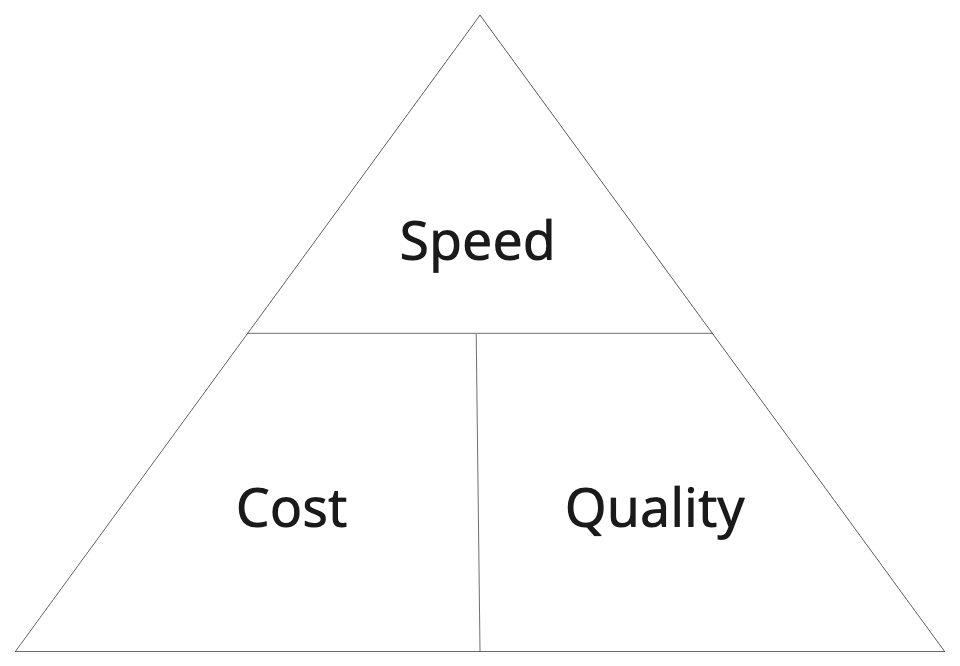

Scale doesn't repeal that law, it just closes the loopholes. So engineers are forced to choose between shipping fast and keeping things healthy, and whichever they pick, the other one quietly waits its turn.
So here's the actual challenge, and it isn't "add more agents." It's how you get faster without quietly paying for it in quality, or in cash, later.

More agents, aimed right, is one way through that trade. Not one agent for several repos carrying every rule Credeq has ever written. Agents built for the repo they live in, carrying only what that repo needs, and nothing else. That's the shape of the proposed fix. What's still missing is the deciding part, which workflows actually deserve an agent and which don't. That starts with finding where engineers lose their time in the first place.

## Code lives and we should know the lifecycle.

To truly understand how we can scale engineering operations, we first need to agree on what an engineer actually does.

Strip away the job titles, the standups, the GitHub issues, and it comes down to, a engineer that writes code, and gets that code into a repository. Everything else, the skills they've picked up, the tools they reach for, exists to serve that one act. A linter, a framework, library, an agent, all of it is just scaffolding around the same two steps. Write the code. Push the code.
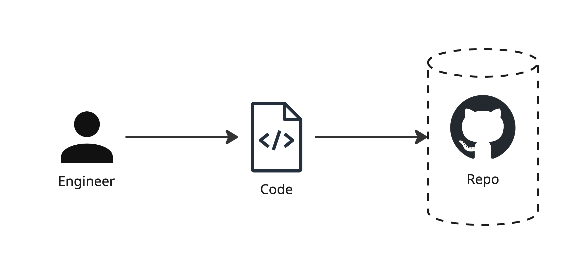

An oversimplification, sure. But a first principle is not the whole picture, it's the part that's true once you start to strip things away. Strip engineering all the way down and it's two steps, solve problems by writing code and share that code. Everything else is a decoration.

In practice, that decoration is most of the job. The loop grows steps around the core principles: plan the change, write it, test it, review it, merge it, ship it, watch it in production, then start over the moment something breaks or something new needs building. That longer loop has a name. It's called the software development lifecycle, and it's where the real bottlenecks live.

### The Software Development Lifecycle

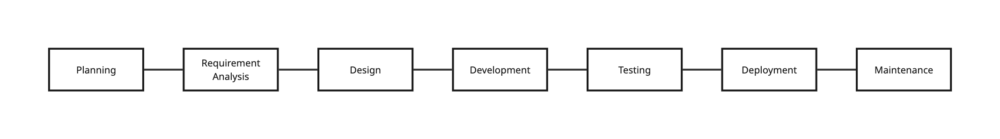

The lifecycle itself is not the problem, the loop is fine, it's been fine for decades. The problem is that each of those seven boxes is actually a bundle of a dozen smaller workflows wearing one label.

Another issue is that not every repository storing code or project follwos the same lifecycle.

Those seven boxes were always just a map, but an engineer fills the gaps with judgement without noticing. That's the craft part of the job, and it's why tools are so often underused, they can't make those judgements, because nobody tells them how. Agents can't either, not until someone decomposes each box into the real workflows living inside it.

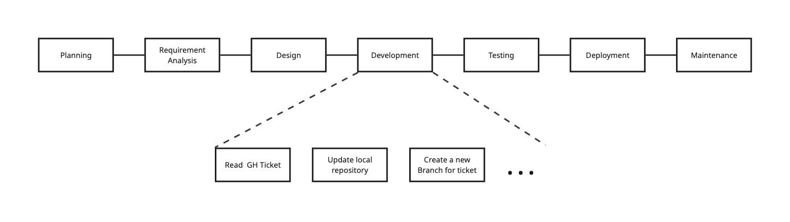


### Scaling the SDL to a Global Data Platform

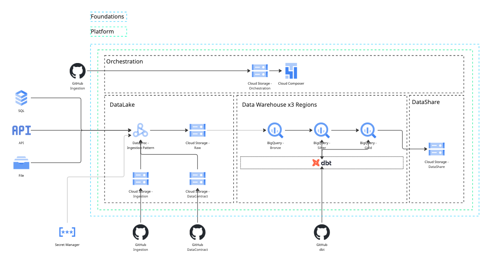

Credeq's global data platform is multiple repositories, and each one runs its own version of that lifecycle, at its own pace, bottlenecked in its own place, for its own reasons.

- **dbt Region** — dbt modules and transformation logic for a specified region
- **Data Platform Foundations** — the infrastructure as code underneath all of it
- **Data Platform** — the modules that build up the data warehouse itself
- **Data Orchestration** — the Airflow DAGs that keep everything running on schedule
- **Data Contracts** — the contracts that govern what's allowed in from ingestion sources

A slow step in dbt Africa isn't the same bottleneck as a slow step in Data Contracts. Before anyone reaches for an agent: define each of these lifecycles on its own terms, and break each one down to the workflow level.

Each lifecycle decomposes into a set of workflows, and that decomposition is what actually shows engineers where the bottlenecks are, and where tooling would strategically help remove them. That's the real unit we need to look at.

If the decomposition honestly and the workflows sort themselves into two kinds.

- **Local workflows**
- **Cross-repo workflow**

Multiple lifecycles, each hiding multiple workflows, some local to a single repo, some stretched across all of them at once. 

This presentes a challange for **One shared skill file**, or **one shared agent** because it can't see this picture, averaging that many different bottlenecks into a single view is how you end up fixing none of them.

## Problem Statement

Putting the problem statement into words.

**Scale Credeq's Engineering operations with AI agents, without compromising on quality or substantually increaing cost.**

Three things in one sentence, and each one can quietly kill the other two. Scale carelessly and quality erodes. Chase velocity and the repos closest to launch cut corners the others won't. Protect quality by slowing everything down and you've just renamed the problem, not solved it. This is the same trade from earlier, speed, quality and cost.

An AI agent is just another tool, not a strategy, but also not quite tha same category as a linter or a CI pipeline. Yet the tool is only as good as the **bottleneck** it gets pointed at. Aim it at nothing in particular and it's just an expensive way to feel busy.

"Real tools get treated like tools". Nobody installs a linter without knowing exactly what it's not allowed to break. Nobody keeps a CI pipeline that can't show you what it caught. A tool earns its place **twice**, once before it goes in, checked against the constraints, and once after, against a number somebody actually reads. Agents don't get an exemption because they can talk or use stats to "reason".

### Problem Statement Components

What the problem statement is actually made of, the moving parts that everything above was building toward.

- **Engineers** — the people whose judgment decides which tool gets used, where, and whether an agent belongs in the loop at all.
- **Tool usage** — agents, CI, cli tools... anything that turns judgment into leverage.
- **Processes** — the workflows, global and local, that all of this actually has to run inside.

### Problem Statement Constraints

What the solution isn't allowed to sacrifice to get there.

- **Quality** cannot be compromised.
- **Speed** should increase.
- **Cost** should be minimized.

These aren't three rules of the same kind. Quality and cost are gates, you check them going in, and a violation vetoes the agent. Speed can function as a scoreboard you check it coming out, to see if the whole implementation paid off. Gates before, scoreboard after, mix them up and you get agents that are very fast at making things worse.
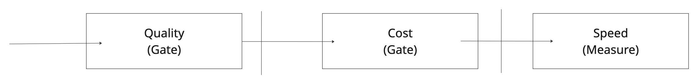

## An Agent Is Just an Application

### Agent explanation

Google's [architecture guidance](https://docs.cloud.google.com/architecture/choose-agentic-ai-architecture-components) defines an agent as an application that achieves a goal by processing input, performing reasoning with available tools, and taking actions. Read it twice, because the word doing the work is *application*. Not a colleague, not a strategy, an application with a model sitting where the business logic used to sit. The reasoning is new. The rest is the same anatomy every tool has, inputs it accepts, tools it's allowed to touch, and a goal somebody defined.

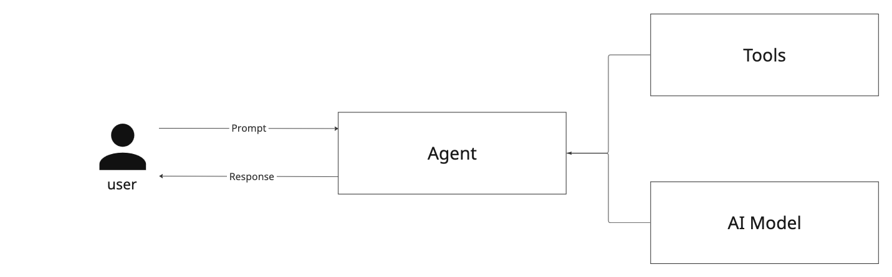

### Design patterns to note

#### Orchestrator pattern

Google calls this the [coordinator pattern](https://docs.cloud.google.com/architecture/choose-design-pattern-agentic-ai-system), one central agent takes the request, breaks it into sub-tasks, and dispatches each piece to a specialized agent. The coordinator doesn't do the work. It routes the work. That's useful precisely when the routing itself needs judgment, which is what a cross-repo workflow looks like from the outside.
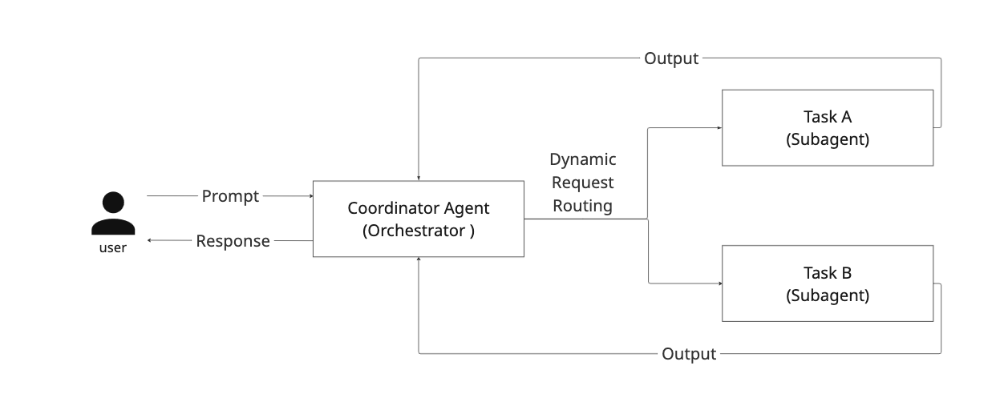
Its stricter cousin is the **multi-agent sequential pattern**. This pattern includes specialized agents in a fixed order, each one's output becoming the next one's input. Google's guidance recommends it for highly structured, repeatable processes, and the example they reach for is data pipelines.

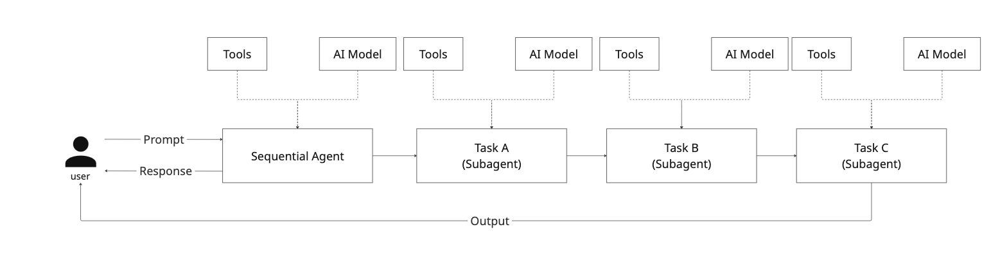

#### Hyper-specific single agent

This is Google's single-agent system with the scope turned all the way down: one model, a defined set of tools, a system prompt that covers one workflow and nothing else. Small enough to reason about, cheap enough to run, and it sidesteps the failure mode Google names [tool bloat](https://docs.cloud.google.com/architecture/choose-agentic-ai-architecture-components), tool definitions piling up in a system prompt until the model gets less accurate and more expensive at the same time. In a shared agent, every rule added for one repo is noise every other workflow has to pay for. Decomposing isn't a style preference. It's how the quality gate stays closed.

Two things follow, and they're easy to confuse. The **framework** is the *decision* — whether an agent belongs and where — and it can answer no. The **architecture** is the *build* — what you actually stand up, but only for the workflows the framework didn't already reject. Framework first, because there's no point designing a system for an agent that shouldn't exist.

## The Framework

Everything above collapses into a cascade. Five things to identify, in order, and then a verdict. Each step narrows the scope of the one above it, so by the time you reach the bottom the thing you're deciding about is small enough to actually judge. Run it the same way every time and the judgment stops being a call only the seniors can make, it becomes a procedure anyone can run.

1. **Identify the lifecycle.** Which SDL are you standing in, and is it local to one repo or stretched across the platform.
2. **Identify the steps.** Which boxes of that lifecycle the work actually touches. Almost never all seven.
3. **Identify the workflow.** Inside those steps, the real unit of work, named specifically enough that you could hand it to someone.
4. **Identify the permissions.** What that workflow has to be allowed to do. Read or write, and write to what.
5. **Identify the tools.** The smallest set that can do it, and nothing held back "just in case."
6. **Check the gates.** Cost and quality, priced against steps 4 and 5. If either fails, stop. **No is a fine answer.**

The order isn't cosmetic, and the gates moving to the end is the part worth arguing about. You can't price them earlier. Cost is a function of how many tools a call carries and how much context it drags along, that's step 5. Quality risk is a function of what the thing is allowed to mutate, that's step 4. Check the gates before you've answered those and you're guessing at both. Check them after and you're reading numbers off two lines you just wrote down.

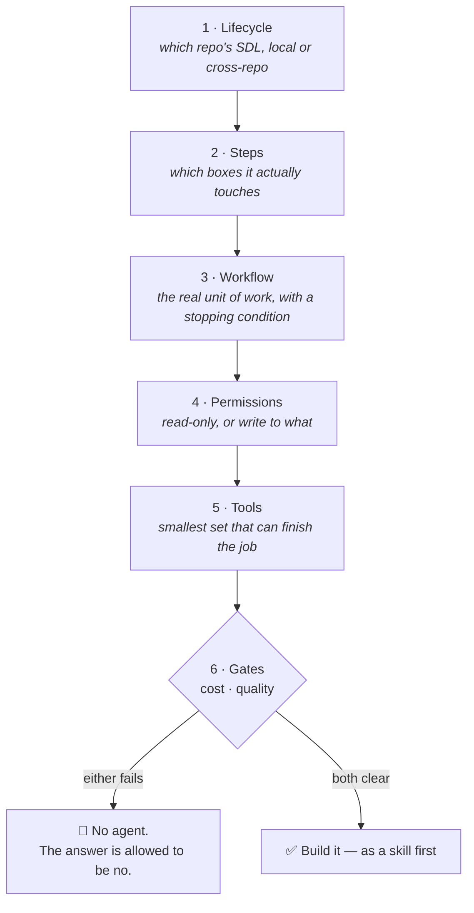

### Step 1 — Identify the lifecycle

Not "the SDLC," singular. There isn't one. There's dbt Region's lifecycle, and Data Contracts' lifecycle, and Data Platform Foundations' lifecycle, and they are bottlenecked in different places for different reasons. Pick the wrong one and every step below inherits the error.

The second half of this step does more work than it looks like. **Local or cross-repo** decides who owns the thing, who reviews it, and whether it needs a central hop at all. A local workflow is the cheap common case, one repo, one owner, one lifecycle. A cross-repo workflow fails differently, not inside a repo but in the handoffs between them, and it's the only case where routing itself needs judgment.

*Failure mode:* answering with the generic seven boxes and building against a lifecycle nobody actually runs.

### Step 2 — Identify the steps in that lifecycle

The seven boxes are a menu, not a checklist. Building a conformed dimension touches plan, code, test, and review. It does not touch deploy, operate, or monitor, those belong to Composer and whoever's on call. Writing that down is how you stop scope from creeping, because an agent that starts helpfully at "plan" and quietly ends up at "deploy" didn't misbehave, it was just never told where to stop.

In a cross-repo workflow this step changes shape, "which steps" becomes "whose steps." A new field from an ingestion source is Data Contracts' code step, then Data Orchestration's, then Data Platform's, then a dbt region's. Four repos, four owners, and the boundaries between those steps are the handoffs, which is exactly where this class of workflow breaks.

*Failure mode:* naming steps you don't touch, and getting an agent with opinions about deployment.

### Step 3 — Identify the workflows in those steps

This is the unit everything else is measured against. Not "testing," but "regenerate the Silver-layer config when a new source table lands." Not "improve dbt," which is a wish. One workflow, one name, one thing.

The test for whether you've actually got a workflow and not a box wearing a workflow's name: **can you state the stopping condition?** If you can't say what "done" looks like, in terms something other than the agent's own opinion, you're still one level too high. Keep decomposing. A workflow you can't finish is a workflow you can't gate, and a workflow you can't gate never should have made it to step 6.

*Failure mode:* stopping at the box. Every argument in this document about narrow scope, lean prompts, and avoiding tool bloat depends on this step being done honestly, and it's the step everyone wants to skip because it's the one that's actual work.

### Step 4 — Identify the permissions the workflow needs

Two questions, and they're both blunt. **Is this read-only or does it mutate something?** And if it mutates, **what exactly?** This repo's files, a BigQuery dataset, a DAG, a contract that four other repos depend on.

Read-only workflows are cheap to say yes to. They can be wrong, but wrong is recoverable, and the gates barely notice them. Mutating workflows are a different conversation, they inherit a human gate, and the wider the blast radius the earlier that gate has to sit. This is the step where least privilege gets decided, and where a prompt injection later either hits a wall or doesn't.

The important structural point, **permissions belong to the workflow, not to the agent.** Write them down here, before anything is built, and they can be enforced later as an IAM boundary the thing physically cannot cross. Leave them until after something is built and they become a paragraph in a system prompt asking nicely.

*Failure mode:* granting the permissions the workflow *might* want. That's how one narrow specialist ends up able to reach into a repo it has no business touching.

### Step 5 — Identify the tools

Smallest set that finishes the job. For a conformed dimension that's roughly three, `dbt_build`, `dbt_validate`, `read_repo`. Not the whole platform toolbox.

The rule that keeps this list short: **a tool only goes on it if you can point at the part of the workflow that calls it.** No candidates, no "while we're here." Tool bloat isn't an aesthetic complaint, it's a tax paid on every single invocation, in accuracy and in tokens, and it's the specific failure mode narrow scope exists to avoid.

There's a second payoff that's easy to miss. A tool list built this way is **auditable**. A reviewer can ask "why does this need write access to BigQuery," and either the answer is a named step in step 3, or the tool comes off the list. That's a conversation a shared mega-agent's tool list can never have, because the honest answer there is always "something needs it."

*Failure mode:* the toolbox that grows by accretion, where nobody can say which workflow added what, and removing anything feels risky.

### Step 6 — Check the gates

Now, and only now, the verdict. Steps 1 through 5 produced the two inputs the gates need.

**The cost gate.** What does this cost per invocation, and what would the cheapest thing that already does it cost? Triggering a DAG, merging a release, tagging a version, a GitHub Action does all of that for near nothing and does it deterministically. Pointing an agent at work a pipeline already handles is a cost-gate violation no matter how well the agent performs. The permissions from step 4 and the tools from step 5 are what let you answer this with a number instead of a vibe.

**The quality gate.** Two questions. Can the agent mark its own homework? If the only check on the workflow is the agent declaring itself finished, the gate is already open, and the fix is that verification stays external, `dbt validate`, peer review, legacy comparison, a human. And then the blast-radius question, given exactly the permissions and tools you just listed, what is the worst *correct-looking* wrong output this can produce, and who catches it? If nobody does, the gate fails.

**Speed appears nowhere in this step**, on purpose. Speed is the scoreboard, not a gate. You read it after the thing ships, as a cycle-time delta on a dashboard, and it can't veto anything going in. Mix the two up and you get agents that are extremely fast at making things worse.

If either gate fails, stop. That's not the framework failing, that's the framework working, and it's the outcome for more workflows than anyone selling agents would like to admit.

### What the framework produces

Six steps in, the output isn't a memo, it's a file. The framework's answers are exactly the fields of a skill contract:

```yaml
name: build-conformed-dimension          # step 3 — the workflow
description: Build one conformed dimension end-to-end from Silver models
repo: dbt-region                         # step 1 — the lifecycle
lifecycle_steps: [plan, code, test, review]   # step 2 — and where it stops
permissions: read-write                  # step 4 — write triggers a human gate
tools: [dbt_build, dbt_validate, read_repo]   # step 5 — allowlist, nothing else
answers_to_gates: [dbt_validate, peer_review, legacy_comparison]   # step 6 — external checks it does not own
stopping_condition: "dbt build green OR max 8 tool iterations"     # step 3's honesty test
```

A contract missing any of these didn't finish the framework, and it doesn't ship. That's what makes the scoping enforceable instead of aspirational, and it's the seam into the architecture: the `description` becomes the registry entry that makes the workflow discoverable, and `tools` plus `permissions` become the IAM scope the runtime enforces.

### Running it twice, once for a yes and once for a no

**A yes.** Lifecycle, dbt Region, local. Steps, plan through review. Workflow, build a conformed dimension from Silver models, done when `dbt build` is green. Permissions, read-write inside this repo, plus a BigQuery build target, no other repo. Tools, three. Gates, the cost is one lean model call chain against hours of an engineer rebuilding the same scaffolding by hand, and the quality check is `dbt validate` plus peer review plus a legacy comparison, none of which the agent owns. Both clear. Build it, and build it as a skill.

**A no.** Lifecycle, Data Orchestration, local. Steps, deploy. Workflow, trigger the DAG after a merge, done when the DAG accepts the run. Permissions, write, it kicks a production schedule. Tools, one. Gates, and here it dies, a GitHub Action already does this deterministically for effectively nothing, so an agent adds cost and a reasoning step to a job that needs neither. Cost gate vetoes it. The workflow was real, the decomposition was fine, and the answer is still no.

These aren't house rules. Google's own [guidance on choosing agent design patterns](https://docs.cloud.google.com/architecture/choose-design-pattern-agentic-ai-system) starts from the same axes, the shape of the task, the cost budget, how much human oversight the job demands, before any pattern gets picked.


-- Ignore for now 


## The Proposed Architecture

The architecture is two tiers, and they map directly onto the local-versus-cross-repo distinction from earlier, **distribute the knowledge, centralize only the routing.** By default the specialists aren't standalone agents at all, they're **skill files colocated in the repos they serve**, each carrying only its own repo's scar tissue(logic) and versioned alongside the code it acts on.Execution happens in a coordinator, which does one thing, it routes.

Locally, a repo-local coordinator routes among a repo's own skills, however across repos, a central coordinator invokes each repo's skills in handoff order. Either way the coordinator knows nothing about the domain. It routes; the skills know how. Never the reverse.

**The coordinator succeeds not by knowing things, but by knowing who does.**

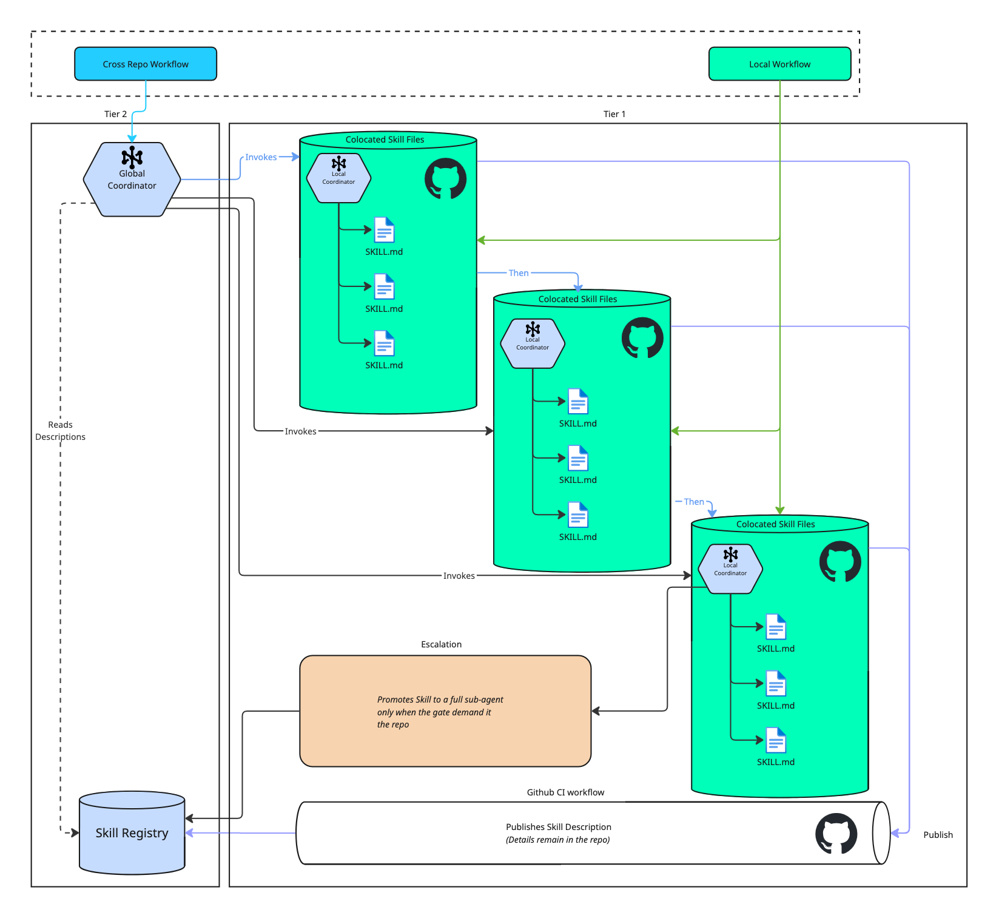

A **local workflow** (green) is handled entirely inside its repo, its own coordinator invoking its own skills, no central hop, which keeps the common case cheap. A **cross-repo workflow** (blue) hits the central coordinator, which reads the skill registry and invokes the colocated skills that own the domain knowledge, in handoff order.

The registry doesn't fill itself, and it isn't filled by hand. The purple path is how a repo surfaces a skill, on merge, a CI step publishes *only that skill's description* to the central registry, never its body. The knowledge stays in the repo while the "pointer" travels. Two things fall out of that. 
- The registry is current the instant a PR lands. 
- Governance is free, it rides on the same CODEOWNERS review that already gates the code. 

With this the thesis holds literally, **distribute the knowledge, centralize only the routing metadata**. The orange is a *different* axis and shouldn't be confused with registration. Escalation changes what a skill **runs as**, a full sub-agent, only when a gate demands something a file can't give. Registration changes how a skill is **found**. One is about runtime, the other about discovery.

### Do the Specialists Need to Be Agents? Skills as the Default

A skill isn't an agent. An agent is an application with its own model, tools, and reasoning loop. A skill is passive knowledge, a file that gets loaded into a running agent's context when it's invoked, and does nothing on its own. So Tier 1 isn't really "agents living in repos." It's knowledge files living in repos, plus one host agent that loads the right one at the right time. The knowledge stays distributed; the execution centralizes into the host. That's the thesis.

Framed as skills, most of the argument gets *stronger*. **Ownership and colocation** stop being aspirations.A skill is just a markdown file in the repo, versioned with the code, reviewed in the same PR, owned by the same CODEOWNERS, with no separate service to deploy or secure. **The registry comes for free**, it's just the set of skill descriptions the host can see. Discoverability isn't something we have to build, it's something we already have. And **the cost gate holds through progressive disclosure**. Progresive Disclosure allows the one-line description to stay in context cheaply, the body loads only on invocation, so only the relevant repo's rules ever enter the prompt. That last one has a condition attached, and it matters, the win holds only if skills are *invoked*, not preloaded. Concatenate every repo's skill into one always-on prompt and you've quietly rebuilt the shared mega-agent this whole document argues against.

Two guarantees get *weaker*, and the honest move is to name them rather than let them leak. **Isolation** is the first. Separate agents each run with their own tool permissions, a hard sandbox. Skills all load into the same host's context and share its tool access, so "a narrow specialist can't confidently wander into another repo" stops being an architectural wall and becomes a matter of selective invocation plus a harness that enforces per-skill tool allowlists. If the runtime doesn't scope tools per skill, that guarantee is just a prompt asking nicely. **Independent per-stage execution** is the second. With full agents the handoff is agent-to-agent, and each stage can carry its own model, permissions, and failure domain. With skills the handoff is one host swapping files in sequence, which is fine for the strictly sequential pipeline Credeq actually runs, but it buys no parallelism and no independent failure between stages.

So the rule is, **default to skills, promote to a full sub-agent only where a gate demands it**, its own tools, real parallelism, or independent failure isolation. That's the same "no is a fine answer" discipline from the framework, pointed at the runtime instead of the workflow: don't stand up an agent where a file does the job.

### Composing New Agents From the Registry

Once every skill is discoverable by description, the registry stops being just a routing table and becomes a **menu you compose from**. Defining a new agent no longer means authoring new knowledge. It means three cheap things: 
- Pick a subset of skills from the registry 
- Write a system prompt that states the goal
- Declare a tool allowlist. 

The knowledge already exists, owned and versioned in the repos that wrote it. The new agent is a *selection over the registry*, not a new body of rules.

Two properties keep this honest. **The registry is the allowlist.** You can only compose from skills that were published through a PR, so every agent is assembled from reviewed, owned building blocks, there's no back door that skips governance. And **composition doesn't exempt you from the framework.** Being *able* to snap five skills together doesn't mean an agent belongs there. The cascade still runs, and the gates still get a veto. Composition makes agents cheap to propose, which is exactly why the gates matter more, not less, the easier it gets to assemble one, the more the discipline has to live in deciding whether to. Note the difference from escalation one more time escalation promotes a single skill into its own runtime. Composition assembles many skills into one agent's context. Building blocks, not a promotion.

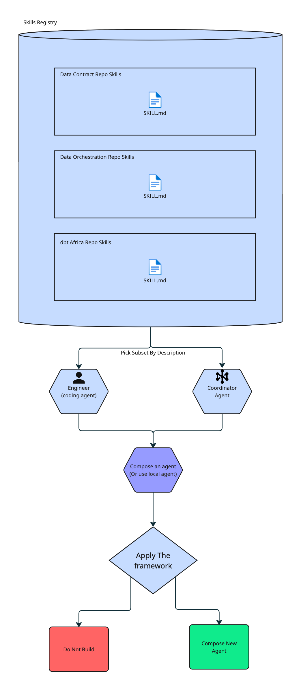

### The Architecture on GCP

The two-tier design maps cleanly onto GCP services, and the mapping is what makes "distribute the knowledge, centralize only the routing" concrete rather than aspirational. Knowledge stays in the repos; one central runtime executes; everything the agent actually touches is already a GCP-managed service Credeq runs today.

| Concept | GCP service | Why |
|---|---|---|
| Skill (knowledge), colocated | repo — GitHub | versioned and governed with the code it describes |
| Publish on merge | **Github Actions** trigger per repo | registration rides the existing CI, no manual step |
| Registry — descriptions + pointers | **Firestore** | cheap structured lookups the coordinator reads to route |
| Skill bundles — derived artifacts | **Artifact Registry** (or GCS) | host loads a built bundle, never clones repos at runtime |
| Host + coordinator runtime | **Cloud Run** | one service, scales to zero, one thing to deploy and secure |
| Reasoning / model | **Vertex AI** — Gemini, or Claude via Model Garden | managed inference, IAM-scoped, no key sprawl |
| Async triggers (Slack bug, ingestion) | **Pub/Sub** + webhook on Cloud Run | decouples the trigger from the run, gives retries |
| Secrets (tokens, model keys) | **Secret Manager** | no credentials baked into skills or images |
| Per-skill tool scoping | **IAM** service accounts / Workload Identity | the tool allowlist becomes a hard boundary, not a prompt |
| Open PRs | GitHub API | the agent hands back at the PR, as designed |
| Trigger DAGs | **Cloud Composer** (managed Airflow) | the DAG steps stay where they already live |
| Build / compare data | **BigQuery** | dbt targets and legacy comparisons run in-warehouse |
| Scoreboard — speed, gate verdicts | **Cloud Logging / Monitoring / Trace** | the "read it after it ships" number, instrumented |
| Escalated sub-agent | dedicated **Cloud Run** service + own IAM | independent runtime and sandbox, only when a gate demands |

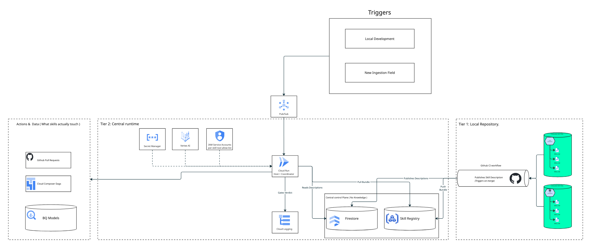

**A local workflow** (dbt dimension) never touches the central plane. The repo-local coordinator runs inside the dbt Region repo's own CI, loads its own skills, acts on BigQuery, and opens a PR. Cheap common case, no central hop.

**A cross-repo workflow** (Slack production bug) posts an event to **Pub/Sub**, which wakes the **Cloud Run** host. The host reads **Firestore** to match the bug against skill descriptions, loads the relevant bundles from **Artifact Registry**, reasons over them with **Vertex AI**, and dispatches to the colocated skills in handoff order, opening PRs via the GitHub API and triggering the right DAG in **Cloud Composer**. Every action runs under a per-skill **IAM** service account, so a skill can only touch what its allowlist grants.

Two GCP details do real work for the framework. **IAM per service account** turns the quality gate's "a narrow specialist can't wander into another repo" from a prompt-level hope into an enforced boundary, the skill physically cannot call what it isn't granted. And **Cloud Logging / Monitoring** is where the speed constraint stops being a claim: gate verdicts and cycle-time deltas get recorded, so "read the scoreboard after it ships" has an actual dashboard behind it. If hand-rolling the host on Cloud Run is more than you want to own, **Vertex AI Agent Engine** is the managed alternative for the runtime tier, the same split still holds, only the host's hosting changes.

### How it addresses speed

Speed is the one the framework reads *after*, the scoreboard rather than a gate, so the architecture earns it in concrete ways instead of claiming it. 

First, it aims the agent at the actual bottleneck, the scaffolding an engineer rebuilds for every model (Bronze and Silver configs, dedup, SCD, mapping), so the number that moves is time-to-PR for a new dimension, hands-on minutes traded for review minutes.

Second, the common case has no central hop, a local workflow goes straight to its repo's coordinator, so the frequent path pays no routing latency at all.

Third, work that used to serialize through one overloaded engineer, or one oversized agent, can run in parallel, independent repo agents and sub-agents proceeding concurrently wherever a handoff allows. And because the skill is already colocated, none of that speed is spent re-discovering the repo's scar tissue, the knowledge is in context the moment the agent starts. Whether it actually paid off isn't a matter of faith, it's the cycle-time delta on the Cloud Logging dashboard, read after it ships.

### How it maintains quality

Narrow scope does most of the work here, an agent that only knows one workflow can't confidently wander into someone else's. For the rest, Google's [review-and-critique pattern](https://docs.cloud.google.com/architecture/choose-design-pattern-agentic-ai-system) pairs the generator with a critic that evaluates the output against criteria and approves it, rejects it, or sends it back. That's the quality gate kept running in production. 

### How it reduces cost

Google's pattern guidance is blunt about the cost driving model calls. Cost scales with how many calls a pattern makes and how much context each call drags along. A hyper-specific agent keeps both small, a lean prompt, no tool bloat tax, no reasoning through five repos' worth of rules to answer a question about one. That saving lands on every single invocation, which is the kind that compounds quietly.