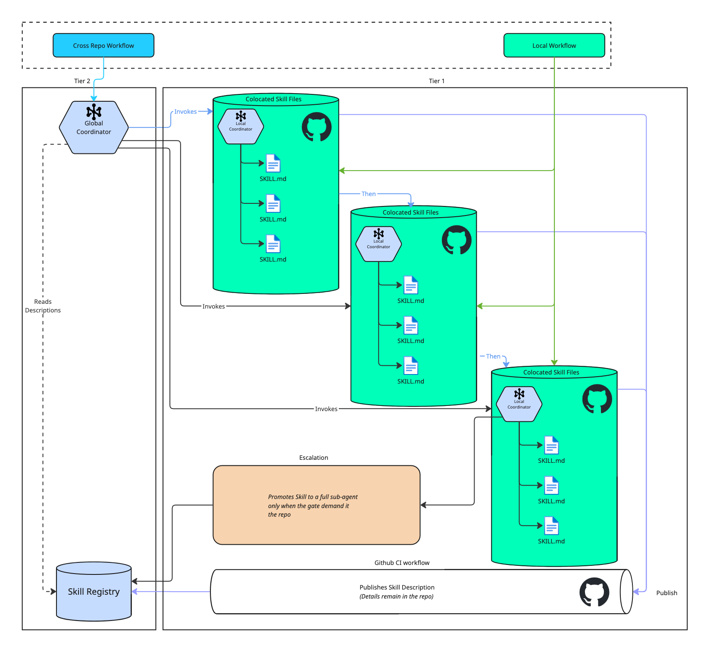
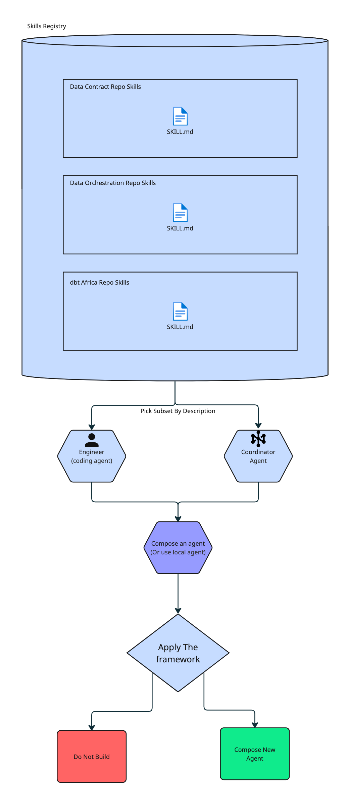
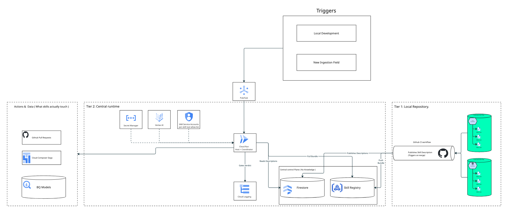

# The Proposed Architecture

The architecture is two tiers, and they map directly onto the local-versus-cross-repo distinction from earlier, **distribute the knowledge, centralize only the routing.** By default the specialists aren't standalone agents at all, they're **skill files colocated in the repos they serve**, each carrying only its own repo's scar tissue(logic) and versioned alongside the code it acts on.Execution happens in a coordinator, which does one thing, it routes.

Locally, a repo-local coordinator routes among a repo's own skills, however across repos, a central coordinator invokes each repo's skills in handoff order. Either way the coordinator knows nothing about the domain. It routes; the skills know how. Never the reverse.

**The coordinator succeeds not by knowing things, but by knowing who does.**

A **local workflow** (green) is handled entirely inside its repo, its own coordinator invoking its own skills, no central hop, which keeps the common case cheap. A **cross-repo workflow** (blue) hits the central coordinator, which reads the skill registry and invokes the colocated skills that own the domain knowledge, in handoff order.

The registry doesn't fill itself, and it isn't filled by hand. The purple path is how a repo surfaces a skill, on merge, a CI step publishes *only that skill's description* to the central registry, never its body. The knowledge stays in the repo while the "pointer" travels. Two things fall out of that. 
- The registry is current the instant a PR lands. 
- Governance is free, it rides on the same CODEOWNERS review that already gates the code. 

With this the thesis holds literally, **distribute the knowledge, centralize only the routing metadata**. The orange is a *different* axis and shouldn't be confused with registration. Escalation changes what a skill **runs as**, a full sub-agent, only when a gate demands something a file can't give. Registration changes how a skill is **found**. One is about runtime, the other about discovery.

### Do the Specialists Need to Be Agents? Skills as the Default

A skill isn't an agent. An agent is an application with its own model, tools, and reasoning loop. A skill is passive knowledge, a file that gets loaded into a running agent's context when it's invoked, and does nothing on its own. So Tier 1 isn't really "agents living in repos." It's knowledge files living in repos, plus one host agent that loads the right one at the right time. The knowledge stays distributed; the execution centralizes into the host. That's the thesis.

Framed as skills, most of the argument gets *stronger*. **Ownership and colocation** stop being aspirations.A skill is just a markdown file in the repo, versioned with the code, reviewed in the same PR, owned by the same CODEOWNERS, with no separate service to deploy or secure. **The registry comes for free**, it's just the set of skill descriptions the host can see. Discoverability isn't something we have to build, it's something we already have. And **the cost gate holds through progressive disclosure**. Progresive Disclosure allows the one-line description to stay in context cheaply, the body loads only on invocation, so only the relevant repo's rules ever enter the prompt. That last one has a condition attached, and it matters, the win holds only if skills are *invoked*, not preloaded. Concatenate every repo's skill into one always-on prompt and you've quietly rebuilt the shared mega-agent this whole document argues against.

Two guarantees get *weaker*, and the honest move is to name them rather than let them leak. **Isolation** is the first. Separate agents each run with their own tool permissions, a hard sandbox. Skills all load into the same host's context and share its tool access, so "a narrow specialist can't confidently wander into another repo" stops being an architectural wall and becomes a matter of selective invocation plus a harness that enforces per-skill tool allowlists. If the runtime doesn't scope tools per skill, that guarantee is just a prompt asking nicely. **Independent per-stage execution** is the second. With full agents the handoff is agent-to-agent, and each stage can carry its own model, permissions, and failure domain. With skills the handoff is one host swapping files in sequence, which is fine for the strictly sequential pipeline Credeq actually runs, but it buys no parallelism and no independent failure between stages.

So the rule is, **default to skills, promote to a full sub-agent only where a gate demands it**, its own tools, real parallelism, or independent failure isolation. That's the same "no is a fine answer" discipline from the framework, pointed at the runtime instead of the workflow: don't stand up an agent where a file does the job.

### Composing New Agents From the Registry

Once every skill is discoverable by description, the registry stops being just a routing table and becomes a **menu you compose from**. Defining a new agent no longer means authoring new knowledge. It means three cheap things: 
- Pick a subset of skills from the registry 
- Write a system prompt that states the goal
- Declare a tool allowlist. 

The knowledge already exists, owned and versioned in the repos that wrote it. The new agent is a *selection over the registry*, not a new body of rules.

Two properties keep this honest. **The registry is the allowlist.** You can only compose from skills that were published through a PR, so every agent is assembled from reviewed, owned building blocks, there's no back door that skips governance. And **composition doesn't exempt you from the framework.** Being *able* to snap five skills together doesn't mean an agent belongs there. The three steps still run, and the gates still get a veto. Composition makes agents cheap to propose, which is exactly why the gates matter more, not less, the easier it gets to assemble one, the more the discipline has to live in deciding whether to. Note the difference from escalation one more time escalation promotes a single skill into its own runtime. Composition assembles many skills into one agent's context. Building blocks, not a promotion.

### The Architecture on GCP

The two-tier design maps cleanly onto GCP services, and the mapping is what makes "distribute the knowledge, centralize only the routing" concrete rather than aspirational. Knowledge stays in the repos; one central runtime executes; everything the agent actually touches is already a GCP-managed service Credeq runs today.

| Concept | GCP service | Why |
|---|---|---|
| Skill (knowledge), colocated | repo — GitHub | versioned and governed with the code it describes |
| Publish on merge | **Github Actions** trigger per repo | registration rides the existing CI, no manual step |
| Registry — descriptions + pointers | **Firestore** | cheap structured lookups the coordinator reads to route |
| Skill bundles — derived artifacts | **Artifact Registry** (or GCS) | host loads a built bundle, never clones repos at runtime |
| Host + coordinator runtime | **Cloud Run** | one service, scales to zero, one thing to deploy and secure |
| Reasoning / model | **Vertex AI** — Gemini, or Claude via Model Garden | managed inference, IAM-scoped, no key sprawl |
| Async triggers (Slack bug, ingestion) | **Pub/Sub** + webhook on Cloud Run | decouples the trigger from the run, gives retries |
| Secrets (tokens, model keys) | **Secret Manager** | no credentials baked into skills or images |
| Per-skill tool scoping | **IAM** service accounts / Workload Identity | the tool allowlist becomes a hard boundary, not a prompt |
| Open PRs | GitHub API | the agent hands back at the PR, as designed |
| Trigger DAGs | **Cloud Composer** (managed Airflow) | the DAG steps stay where they already live |
| Build / compare data | **BigQuery** | dbt targets and legacy comparisons run in-warehouse |
| Scoreboard — speed, gate verdicts | **Cloud Logging / Monitoring / Trace** | the "read it after it ships" number, instrumented |
| Escalated sub-agent | dedicated **Cloud Run** service + own IAM | independent runtime and sandbox, only when a gate demands |

**A local workflow** (dbt dimension) never touches the central plane. The repo-local coordinator runs inside the dbt Region repo's own CI, loads its own skills, acts on BigQuery, and opens a PR. Cheap common case, no central hop.

**A cross-repo workflow** (Slack production bug) posts an event to **Pub/Sub**, which wakes the **Cloud Run** host. The host reads **Firestore** to match the bug against skill descriptions, loads the relevant bundles from **Artifact Registry**, reasons over them with **Vertex AI**, and dispatches to the colocated skills in handoff order, opening PRs via the GitHub API and triggering the right DAG in **Cloud Composer**. Every action runs under a per-skill **IAM** service account, so a skill can only touch what its allowlist grants.

Two GCP details do real work for the framework. **IAM per service account** turns the quality gate's "a narrow specialist can't wander into another repo" from a prompt-level hope into an enforced boundary, the skill physically cannot call what it isn't granted. And **Cloud Logging / Monitoring** is where the speed constraint stops being a claim: gate verdicts and cycle-time deltas get recorded, so "read the scoreboard after it ships" has an actual dashboard behind it. If hand-rolling the host on Cloud Run is more than you want to own, **Vertex AI Agent Engine** is the managed alternative for the runtime tier, the same split still holds, only the host's hosting changes.

### How it addresses speed

Speed is the one the framework reads *after*, the scoreboard rather than a gate, so the architecture earns it in concrete ways instead of claiming it. 

First, it aims the agent at the actual bottleneck, the scaffolding an engineer rebuilds for every model (Bronze and Silver configs, dedup, SCD, mapping), so the number that moves is time-to-PR for a new dimension, hands-on minutes traded for review minutes.

Second, the common case has no central hop, a local workflow goes straight to its repo's coordinator, so the frequent path pays no routing latency at all.

Third, work that used to serialize through one overloaded engineer, or one oversized agent, can run in parallel, independent repo agents and sub-agents proceeding concurrently wherever a handoff allows. And because the skill is already colocated, none of that speed is spent re-discovering the repo's scar tissue, the knowledge is in context the moment the agent starts. Whether it actually paid off isn't a matter of faith, it's the cycle-time delta on the Cloud Logging dashboard, read after it ships.

### How it maintains quality

Narrow scope does most of the work here, an agent that only knows one workflow can't confidently wander into someone else's. For the rest, Google's [review-and-critique pattern](https://docs.cloud.google.com/architecture/choose-design-pattern-agentic-ai-system) pairs the generator with a critic that evaluates the output against criteria and approves it, rejects it, or sends it back. That's the quality gate kept running in production. 

### How it reduces cost